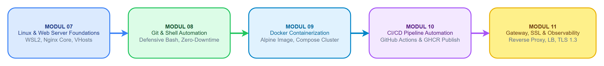

# Basic DevOps Training Curriculum 🚀

Repositori resmi materi pelatihan internal dan panduan laboratorium **Basic DevOps**, dirancang bertahap mulai dari fondasi administrasi Linux & Web Server hingga otomatisasi containerization, CI/CD pipeline, dan arsitektur reverse proxy berstandar industri.

---

## 📚 Peta Kurikulum Pelatihan


*Roadmap Kurikulum Pelatihan Basic DevOps (Draw.io Production Diagram)*  
> 📐 **Berkas Desain Asli:** Berkas skematik draw.io dapat diakses dan disunting pada [`docs/diagrams/curriculum_roadmap.drawio`](docs/diagrams/curriculum_roadmap.drawio).

| Modul | Topik Materi | Dokumen Panduan | Direktori Praktikum |
| :---: | :--- | :--- | :--- |
| **07** | **Dasar Linux & Web Server**<br>WSL, Struktur Direktori Ubuntu, Nginx Server Block, Git Clone | [Buka Modul 7](modul/MODUL_07_DASAR_LINUX_DAN_WEBSERVER.md) | [`labs/lab-07-linux-webserver/`](labs/lab-07-linux-webserver/) |
| **08** | **Otomasi Git & Shell Scripting**<br>Git Workflow, Defensive Shell Scripting, Zero-Downtime Reload, cURL Health Check | [Buka Modul 8](modul/MODUL_08_OTOMASI_GIT_DAN_SHELL_SCRIPTING.md) | [`labs/lab-08-automation/`](labs/lab-08-automation/) |
| **09** | **Containerization dengan Docker**<br>Docker Engine, Dockerfile, Nginx Alpine, Bind Mount Volume, Docker Compose | [Buka Modul 9](modul/MODUL_09_CONTAINERIZATION_DOCKER.md) | [`labs/lab-09-docker/`](labs/lab-09-docker/) |
| **10** | **CI/CD Pipeline dengan GitHub Actions**<br>Automated Linting, Docker Build & Push ke GHCR, GitHub Secrets | [Buka Modul 10](modul/MODUL_10_CICD_GITHUB_ACTIONS.md) | [`labs/lab-10-cicd/`](labs/lab-10-cicd/) |
| **11** | **Reverse Proxy, SSL & Observability**<br>Nginx Gateway, Round-Robin Load Balancing, OpenSSL HTTPS, Access Log Analytics | [Buka Modul 11](modul/MODUL_11_REVERSE_PROXY_SSL_OBSERVABILITY.md) | [`labs/lab-11-reverse-proxy/`](labs/lab-11-reverse-proxy/) |

---

## 🗂️ Struktur Direktori Repositori

```text
basic-devops/
├── .gitignore                                            # Konfigurasi pengabaian file Git
├── README.md                                             # Dokumentasi utama kurikulum
├── assets/                                               # Tangkapan layar visual terminal CLI, peramban & diagram Draw.io
│   ├── kurikulum_devops_roadmap.png                      # Diagram roadmap kurikulum DevOps
│   ├── modul-07/                                         # Diagram arsitektur & screenshot langkah Modul 7
│   ├── modul-08/                                         # Diagram arsitektur & screenshot terminal Modul 8
│   ├── modul-09/                                         # Diagram arsitektur & screenshot Docker Modul 9
│   ├── modul-10/                                         # Diagram arsitektur & screenshot GitHub Actions Modul 10
│   └── modul-11/                                         # Diagram arsitektur & screenshot SSL/Proxy Modul 11
├── docs/                                                 # Dokumentasi, skematik & arsip referensi
│   ├── diagrams/                                         # Berkas skematik Draw.io asli (.drawio)
│   │   ├── curriculum_roadmap.drawio
│   │   ├── modul_07_nginx_architecture.drawio
│   │   ├── modul_08_deployment_pipeline.drawio
│   │   ├── modul_09_docker_architecture.drawio
│   │   ├── modul_10_cicd_pipeline.drawio
│   │   └── modul_11_reverse_proxy_topology.drawio
│   └── references/                                       # Berkas PDF asli modul pelatihan terdahulu (TNL 1-7)
│       ├── README.md                                     # Indeks katalog modul referensi
│       ├── MODUL 1 TNL_VLAN.pdf
│       ├── MODUL 2 TNL_Inter-VLAN Routing.pdf
│       ├── MODUL 3 TNL_Static Routing.pdf
│       ├── MODUL 4 TNL_Dynamic Routing_RIP.pdf
│       ├── MODUL 5 TNL_OSPF Multi-Area.pdf
│       ├── MODUL 6_BGP Enterprise Dual ISP dengan OSPF Backbone.pdf
│       └── MODUL 7 TNL_Dasar Linux dan Dasar Webserver.pdf
├── labs/                                                 # Kode sumber dan lingkungan praktikum mandiri
│   ├── lab-07-linux-webserver/                           # Starter template HTML & config Nginx Modul 7
│   │   ├── index.html
│   │   ├── nginx-default.conf
│   │   └── README.md
│   ├── lab-08-automation/                                # Skrip otomasi shell dan website v1/v2 Modul 8
│   │   ├── deploy.sh
│   │   └── index.html
│   ├── lab-09-docker/                                    # Arsitektur Dockerfile dan Compose Modul 9
│   │   ├── Dockerfile
│   │   ├── docker-compose.yml
│   │   └── src/index.html
│   ├── lab-10-cicd/                                      # Deklarasi pipeline GitHub Actions Modul 10
│   │   ├── .github/workflows/ci-cd.yml
│   │   ├── Dockerfile
│   │   └── index.html
│   └── lab-11-reverse-proxy/                             # Cluster reverse proxy, load balancer & SSL Modul 11
│       ├── docker-compose.yml
│       ├── proxy/nginx.conf
│       ├── app1/index.html
│       └── app2/index.html
├── modul/                                                # Naskah modul panduan teknis berstandar industri
│   ├── MODUL_07_DASAR_LINUX_DAN_WEBSERVER.md
│   ├── MODUL_08_OTOMASI_GIT_DAN_SHELL_SCRIPTING.md
│   ├── MODUL_09_CONTAINERIZATION_DOCKER.md
│   ├── MODUL_10_CICD_GITHUB_ACTIONS.md
│   └── MODUL_11_REVERSE_PROXY_SSL_OBSERVABILITY.md
└── scripts/                                              # Skrip pembantu manajemen repositori
    └── generate_assets.py                                # Generator rendering visual mockups terminal & browser
```

---

## 🛠️ Prasyarat Sistem & Kebutuhan Lab

1. **Sistem Operasi Host:** Windows 10 (versi 2004+) atau Windows 11.
2. **WSL2:** Distribusi Ubuntu 22.04 LTS atau yang lebih baru.
3. **Container Runtime:** Docker Engine di WSL2 atau Docker Desktop terintegrasi WSL2.
4. **Alat Pendukung:** Git, cURL, OpenSSL, dan GitHub CLI (`gh`).

---

## ⚡ Petunjuk Cepat Memulai Praktikum

### 1. Masuk ke Sesi Ubuntu WSL
Buka terminal PowerShell atau CMD Windows, lalu jalankan:
```bash
wsl
```

### 2. Menjalankan Lab 07 (Dasar Linux & Web Server Nginx)
```bash
cd labs/lab-07-linux-webserver
sudo cp index.html /var/www/html/index.html
sudo cp nginx-default.conf /etc/nginx/sites-available/default
sudo nginx -t && sudo systemctl restart nginx
# Akses melalui browser: http://localhost
```

### 3. Menjalankan Lab 08 (Otomasi Deployment Shell Script)
```bash
cd labs/lab-08-automation
chmod +x deploy.sh
./deploy.sh
# Akses melalui browser: http://localhost
```

### 4. Menjalankan Lab 09 (Docker Containerization)
```bash
cd labs/lab-09-docker
docker compose up -d
# Akses melalui browser: http://localhost:8080
```

### 5. Menjalankan Lab 10 (CI/CD Pipeline GitHub Actions)
```bash
cd labs/lab-10-cicd
git init -b main
git add .
git commit -m "ci: inisialisasi workflow pipeline"
# Push ke repositori GitHub pribadi Anda untuk memicu GitHub Actions runner
```

### 6. Menjalankan Lab 11 (Load Balancer & SSL Reverse Proxy)
```bash
cd labs/lab-11-reverse-proxy
mkdir -p certs
openssl req -x509 -nodes -days 365 -newkey rsa:2048 \
  -keyout certs/server.key \
  -out certs/server.crt \
  -subj "/C=ID/ST=Jatim/L=Surabaya/O=Lab/CN=localhost"
docker compose up -d
# Akses melalui browser: https://localhost (Terima peringatan self-signed SSL)
```

---

## 🛡️ Standar Pembelajaran
Setiap modul telah dilengkapi dengan:
- **Tujuan Pembelajaran Spesifik**
- **Dasar Teori & Diagram Alur (Mermaid)**
- **Glosarium Perintah CLI (Sintaks, Akronim/Kepanjangan, dan Fungsi Utama)**
- **Langkah-langkah Praktikum Deterministik dengan Tangkapan Layar Lengkap**
- **Panduan Troubleshooting & Penanganan Edge Cases Lengkap**
- **Evaluasi Praktik Mandiri**
