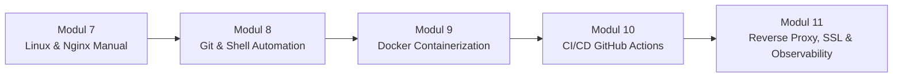

# Basic DevOps Training Curriculum 🚀

Repositori resmi materi pelatihan internal dan panduan laboratorium **Basic DevOps**, dirancang bertahap mulai dari fondasi administrasi Linux & Web Server hingga otomatisasi containerization, CI/CD pipeline, dan arsitektur reverse proxy berstandar industri.

---

## 📚 Peta Kurikulum Pelatihan



| Modul | Topik Materi | Dokumen Panduan | Direktori Praktikum |
| :---: | :--- | :--- | :--- |
| **07** | **Dasar Linux & Web Server**<br>WSL, Struktur Direktori Ubuntu, Nginx Server Block, Git Clone | [Buka Modul 7](modul/MODUL_07_DASAR_LINUX_DAN_WEBSERVER.md) | - |
| **08** | **Otomasi Git & Shell Scripting**<br>Git Workflow, Defensive Shell Scripting, Zero-Downtime Reload, cURL Health Check | [Buka Modul 8](modul/MODUL_08_OTOMASI_GIT_DAN_SHELL_SCRIPTING.md) | [`labs/lab-08-automation/`](labs/lab-08-automation/) |
| **09** | **Containerization dengan Docker**<br>Docker Engine, Dockerfile, Nginx Alpine, Bind Mount Volume, Docker Compose | [Buka Modul 9](modul/MODUL_09_CONTAINERIZATION_DOCKER.md) | [`labs/lab-09-docker/`](labs/lab-09-docker/) |
| **10** | **CI/CD Pipeline dengan GitHub Actions**<br>Automated Linting, Docker Build & Push ke GHCR, GitHub Secrets | [Buka Modul 10](modul/MODUL_10_CICD_GITHUB_ACTIONS.md) | [`labs/lab-10-cicd/`](labs/lab-10-cicd/) |
| **11** | **Reverse Proxy, SSL & Observability**<br>Nginx Gateway, Round-Robin Load Balancing, OpenSSL HTTPS, Access Log Analytics | [Buka Modul 11](modul/MODUL_11_REVERSE_PROXY_SSL_OBSERVABILITY.md) | [`labs/lab-11-reverse-proxy/`](labs/lab-11-reverse-proxy/) |

---

## 🗂️ Struktur Direktori Repositori

```text
basic-devops/
├── .gitignore
├── README.md
├── generate_assets.py
├── assets/
│   ├── modul-07/                                         # Tangkapan layar langkah Modul 7
│   ├── modul-08/                                         # Tangkapan layar terminal & browser Modul 8
│   ├── modul-09/                                         # Tangkapan layar Docker container Modul 9
│   ├── modul-10/                                         # Tangkapan layar GitHub Actions & GHCR Modul 10
│   └── modul-11/                                         # Tangkapan layar SSL, Proxy & Logs Modul 11
├── modul/
│   ├── MODUL_07_DASAR_LINUX_DAN_WEBSERVER.md
│   ├── MODUL_08_OTOMASI_GIT_DAN_SHELL_SCRIPTING.md
│   ├── MODUL_09_CONTAINERIZATION_DOCKER.md
│   ├── MODUL_10_CICD_GITHUB_ACTIONS.md
│   └── MODUL_11_REVERSE_PROXY_SSL_OBSERVABILITY.md
└── labs/
    ├── lab-08-automation/
    │   ├── deploy.sh
    │   └── index.html
    ├── lab-09-docker/
    │   ├── Dockerfile
    │   ├── docker-compose.yml
    │   └── src/index.html
    ├── lab-10-cicd/
    │   ├── .github/workflows/ci-cd.yml
    │   ├── Dockerfile
    │   └── index.html
    └── lab-11-reverse-proxy/
        ├── docker-compose.yml
        ├── proxy/nginx.conf
        ├── app1/index.html
        └── app2/index.html
```

---

## 🛠️ Prasyarat Sistem & Kebutuhan Lab

1. **Sistem Operasi Host:** Windows 10 (versi 2004+) atau Windows 11.
2. **WSL2:** Distribusi Ubuntu 22.04 LTS atau yang lebih baru.
3. **Container Runtime:** Docker Engine di WSL2 atau Docker Desktop terintegrasi WSL2.
4. **Alat Pendukung:** Git, cURL, OpenSSL, dan GitHub CLI (`gh`).

---

## ⚡ Petunjuk Cepat Memulai Praktikum

### 1. Masuk ke Sesi Ubuntu WSL
Buka terminal PowerShell atau CMD Windows, lalu jalankan:
```bash
wsl
```

### 2. Menjalankan Lab 08 (Otomasi Deployment Shell Script)
```bash
cd labs/lab-08-automation
chmod +x deploy.sh
./deploy.sh
```

### 3. Menjalankan Lab 09 (Docker Container)
```bash
cd labs/lab-09-docker
docker compose up -d
# Akses melalui browser: http://localhost:8080
```

### 4. Menjalankan Lab 11 (Load Balancer & SSL Reverse Proxy)
```bash
cd labs/lab-11-reverse-proxy
mkdir -p certs
openssl req -x509 -nodes -days 365 -newkey rsa:2048 \
  -keyout certs/server.key \
  -out certs/server.crt \
  -subj "/C=ID/ST=Jatim/L=Surabaya/O=Lab/CN=localhost"
docker compose up -d
# Akses melalui browser: https://localhost (Accept Self-Signed Certificate)
```

---

## 🛡️ Standar Pembelajaran
Setiap modul telah dilengkapi dengan:
- **Tujuan Pembelajaran Spesifik**
- **Dasar Teori & Diagram Alur (Mermaid)**
- **Langkah-langkah Praktikum Deterministik**
- **Panduan Troubleshooting & Penanganan Edge Cases Lengkap**
- **Evaluasi Praktik Mandiri**
