# Modul 7
## Dasar Linux dan Dasar Web Server

---

### 1. Tujuan Pembelajaran
- Memahami konsep dasar sistem operasi Linux Server dan arsitektur hierarki direktori Ubuntu.
- Memahami konsep dasar web server serta cara kerja Nginx dalam melayani request HTTP.
- Memasang dan mengonfigurasi Windows Subsystem for Linux (WSL) sebagai lingkungan server lokal.
- Menginstalasi, mengoperasikan, dan memverifikasi layanan web server Nginx pada Linux.
- Menggunakan Git dasar untuk mengunduh kode sumber website statis.
- Mengonfigurasi Virtual Host (*server block*) Nginx dan menguji akses website melalui browser host Windows (`localhost`).

---

### 2. Dasar Teori

#### 2.1 Linux Server
Linux Server adalah sistem komputer yang menggunakan sistem operasi berbasis kernel Linux untuk menyediakan berbagai layanan jaringan (*network services*), seperti web server, database server, file sharing, dan application hosting. Linux server banyak digunakan di lingkungan industri karena bersifat *open-source*, memiliki stabilitas tinggi, hemat konsumsi sumber daya, serta dilengkapi manajemen perizinan (*permissions*) yang aman.

Dalam administrasi server, pemahaman struktur direktori Linux sangat penting agar administrator mengetahui lokasi file konfigurasi, data aplikasi, serta log sistem.

**Tabel 1. Struktur Direktori Utama Ubuntu Linux**
| Direktori | Deskripsi dan Fungsi |
| :--- | :--- |
| `/` | *Root directory*, direktori tertinggi tempat seluruh file dan hierarki sistem Linux berada |
| `/home` | Menyimpan file dan data pribadi milik masing-masing pengguna (*user*) |
| `/etc` | Menyimpan seluruh file konfigurasi sistem dan layanan (termasuk Nginx) |
| `/var` | Menyimpan data dinamis yang sering berubah, seperti log sistem (`/var/log`) dan file web default (`/var/www/html`) |
| `/var/www/html` | Lokasi default *document root* penyimpanan file website pada web server |
| `/bin` | Berisi file biner program dasar Linux yang esensial untuk seluruh pengguna |
| `/usr` | Menyimpan file aplikasi, pustaka (*libraries*), dan dokumentasi tambahan pengguna |
| `/tmp` | Tempat penyimpanan file sementara yang dibersihkan secara berkala oleh sistem |
| `/boot` | Berisi file kernel Linux dan konfigurasi boot loader |
| `/dev` | Menyimpan representasi file untuk perangkat keras (*device nodes*) |
| `/proc` | Sistem file semu (*virtual filesystem*) berisi status kernel dan informasi proses |

#### 2.2 Web Server dan Nginx
Web server adalah layanan perangkat lunak yang berfungsi menerima permintaan (*request*) berbasis protokol HTTP/HTTPS dari klien (melalui peramban web seperti Chrome, Firefox, Edge), kemudian memproses dan mengirimkan berkas respons (*response*) yang diminta (seperti HTML, CSS, JavaScript, gambar, atau data JSON).

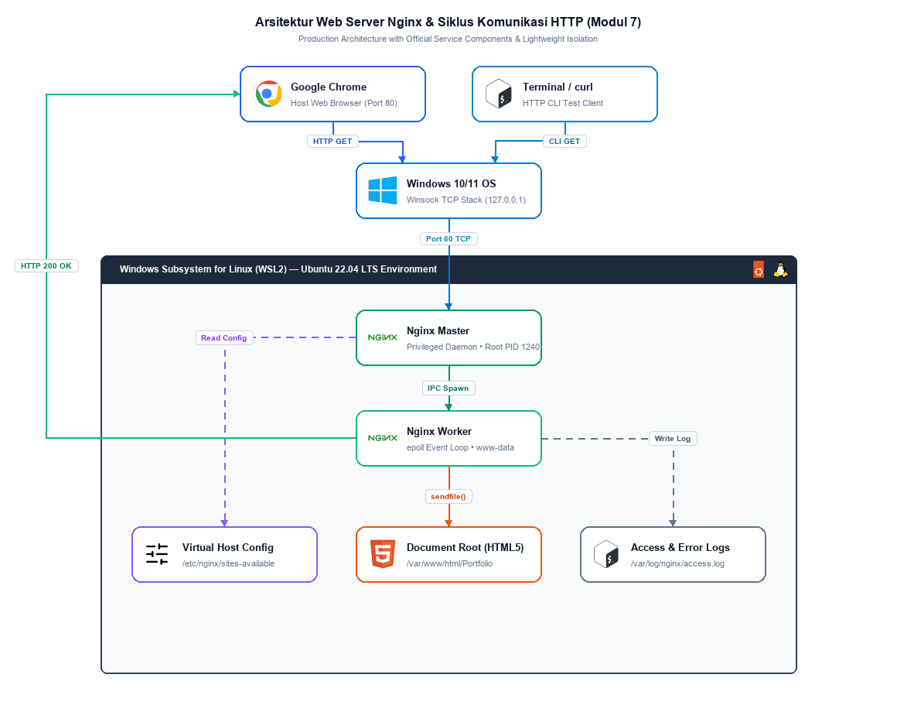
*Gambar 1. Arsitektur Komponen Web Server Nginx dan Alur Komunikasi HTTP antara Host Windows dan WSL2 Ubuntu*

> **Diagram Arsitektur Draw.io**: Berkas diagram vektor dapat disunting langsung di [`assets/modul-07/00_arsitektur_webserver_nginx.drawio`](../assets/modul-07/00_arsitektur_webserver_nginx.drawio) atau dibuka via [Draw.io Online Viewer/Editor](https://viewer.diagrams.net/?tags=%7B%7D&lightbox=1&edit=_blank#R7Vxbc9o4FP4t%2B8BM8kDGl2DIIxDSZjZNMoE226eOsAVoYyxWliHZX786uhiD7SwBSk3STifYknwkHZ3vO8e6uOZ2a%2B7V8zSsOdYcs5jQqOZe1hzHPrPEX5GKI58GJBqr5K%2BDq3oLMtyrmturWe2a250%2Bj0iIRdEJjbkqFjC0IFQJWBHreGeWkqyediz473YDgsYMTcVNhKZYlW2L5zh%2B4gmrP%2BJhjJmQVP9CgySsN5VoEqiSU5VYD8l4wuuI%2BZP1Gkw90%2BdPDM0mQgqGLgfPureOpbsbvOgUy6SMmanGXib0yb%2FYFNSpCQlwvFKQUxpyMltN9GkUYZ%2BvpCHG6GK12IiGq7XO0BjnEvo%2BCvOpjyTgE51qe9Yy4zMGBamcC0dnDJH%2FNGY0iXR9NccdyX8qe4qMLF0%2BnqCALjJJeT0bbTNKeWn2cki6OAwzo6nrqTlXb3821QLDES8R96rEP%2Bp1cTEgXFr0Z4wCzMTFyRcSkSkKibBwxwLzYdGpuBKl39xGDsJ%2FTLRoCREUJtho3wtFwzsjGnFpLSFlMsf7JwFldsTwWCO76aBskhXzF20IJhEE1GNpptA625s9q6IyY6EtAbKG0tQ6WXneGH6XABSlBATF375Eobi4HZPoWfbRQ9OZKKz%2BQhHyFCaxuPiTTpOIPKGYgCYHg3upR4CquGiemp6KgVGdVZWa5CFbT3lNJd5587w1fKNKbK2S9X7fM9FInwNpOVZbsInQgi%2B0ABaxIAIOjnU3GhGfoFCrhPiQ16XTGY2E4cWFirkBlWvFO9Z1TEOk6ijRg7PSCYfjZ0ifcEHW7qUNkgXfAa%2F6okoxKG5HDA0nghLaOmNKggAe7zAsuo2GUpSwyc6MEmilkNvo1BqXICvhVKlGio45o0%2B4q1UdiV6B%2FkgYriWlFC9aV4pA%2BzWWyPEzplPM2Yu41xLdcw1hTc0G0YslzZ23dNokw3DmMaSZdZxK3pReRBmN3o2ZA6p6639hGu3vvQcwSWWZ3Zvr3u0gk76d1A3ISTW6i1iwrP0TpWPJft0JExrbkuV8IfOHryWUkNxwI5i6hrk08lUzDAsWATjXgxRhw%2F%2BnmXiGojfRx1q7NBUVteszle5DUWkHfL5yLveUQXrLypKiakcJGUh%2FjQNDBMzXAYktgNZZAGH1Z8iHlIWId1ZpIwvjpbNfx7zIcRqei4dpjgkrnLNGhnxCPNJa80WUeCPvLr0WJJlAwToUUdirRNFq5IgiJYUsUTSdfRPFG3BCREBYjpO1YRcqncGlCEUgGsyO6jr3czrLpN6gIQ7vBcNzFYoPKed0KgpISe14pkJSGClkbkbkGSysoyu7nHAOsWwbFOJc%2BUF09ncswmgyZ2cRFvZ7NRae8SrAc%2BhSvLwUVybF9FNf1CkjIo5A4Vk8H29qJGvEsr252N6KtZjbjLW4rbyxmLSDehVN0I4imQFmU9Cark8Q0NeHGygVEixDpO35OmHhwdk63x3ZiqpwtgpchUuWmpcEbhRdIa62nNa53zwervaOl6uLMfLOmHqI4on%2B2YGltao%2BBEfvFvlrav9814e4%2F64PcXh70Htsfz9Y%2BO%2BqJjySKIDZKMGWoCrbhmbpwJVEMfWfdvEwCyPiwE6mqFeg5Yp4maVmB11wN32O5N2J7TRhxvTMrtargWU1W8ERuZtzb20OwbaOxd%2BUI%2BaduZyFgmgrc7m968lo7bf3%2BV%2FvY6i%2FfwNNvLm%2B%2FfqX%2BO3dfrt%2BuLv9ouaiune3g%2Fb17c%2Bdj8o7DUGtiESY%2FVjE%2BbBryer9ZBi%2FxBxP5Qw3k9OtUQIz1CfQq9PsjOw0gOBGEvTXYRLxBPyvc2adw1MDcL29aE4YjaYyyl%2BH2YJMQyRnP2OOGNf06nowz1rCvV4Bt7ZGaOQXcavrntuNRp5btaPp66bY5j5D73BfyN%2B6zVdlbdD5sN6xVsbGzoU7LJ54LiR451CcbrurnO66eU6%2FsAo4veH%2Bipnh1NRu6JiChUfZBaZtsCHdQ6LFvnfvYPqpL%2BqzUNDCm9zCOpNsb3mtNctr5mMJJ292zgFDCWVyhgIH8u9%2B7S5Ust%2B72eluqt%2FtwpE92p1XDbvb%2FJ3yXAUWZrX4C4q5NLt7Rn0cg%2BM%2B%2BYQ4XqCXdPavn8xgRTWm7HSXF82prurA75nrPa3I%2B%2BU9I3MS4jGGQblEeCrXtms9p9ayam3Q0QPs1RADcw2Rmi3fhar0vtm48LyLA75v7hG17rq3OJpXz1IMvTOSjxRo1e%2F275xLdX2kRanGKsU%2FUva0TvG9uVBU%2FVJwEI7k25Uoi3di94Wu5Rexu%2BlkRdgdz6hUkdSzjPQEylbpfbFY1APEUaVY3baGFy37fbB6uoP0CGYUy8Dzm9YLpxJTdX0kWvcU8XwjjCdybV6vAXVpNCLjXbh7LveJH5q6SztSEQ4XDcDcz1gt7L2N62iOSCh3blaJuFvDhj%2FyjpO413aTuo2j4e0y4FSXthlanI0JnyTDJMYMBlGM6JkvhDpXYeKTANfTiRZ5CypCJEvicSiSWVyfCP7%2BF6zg7QSe6m1%2F%2FN3K87dXwN%2Fer%2BPvpiKdS%2BonahnDvOH3OWUwViIu%2Fzz4ctOAUJ0yPqIhoTvF5LERfGBmz3dRdey0Stw%2BRwzWNRcL8VcC0rlKtV4paseo0bL89xGTHxG3l4PnnQXl0N6G%2Bd0%2BKM%2Fo6yNF5S1FN21fT63c0HG8C2eH8vkDE3ba%2BvwZqR5javFetqtq9C20lQnQkezGmUysEIGnHTlCAvecoyXwEiT93hac526jqg8Rjm%2B3Vap3%2BanXVwyptl7d9rqDu4f%2Bz98M3Avku4E5iZgeAYTHd90BjIVsfXTnR%2BGeRn3Y4lNvkEMOPGu2PonAeULHVNheb5m6tvlqWUbOhqvEvzHnL5p04cTrKgI3PgC3tvPKyu%2B8Sr1fCLjtpEfsixhcFaFMvOZmsv1h0MDQKvxM%2BF8AbUngcPddtxeuL5816uXNi7mJhFmrh5yGuf%2BezVw%2BJ%2B9eVggfdP36ri0xNDRhPi4568kRG%2BP9bcdkGI5Kz1fbdFAUa1ToXfpdea5hn5gQAosRoc4dVQUQZaeMjgkQzYMBIj0o9F7hsDwxYgCgEJHb7nNySRjEJI71TcczcmpqsfU3NCRqoNKyPQrpkWpzpKIK6Hnt0MTR4OdQ8Fk595BD0E57LSoDIL09LsWJ8ShmD8XPwY3SXdky8PV9F2aJZ2gRVQM1r239%2BrCoKTgXkUNQlhrzLmiXVe3KAKhRDKDyVeuTG4qCNGEfMCpelXvAmWoqgaOyNVuRAudh0rp%2BAaQygFrC6%2Fggtcs6Y2UQpfd9pC5IIyqzahjjKNBf%2FGPCynfCkGKh0tUPU9XJaSUg9Ora2G9X9ApusrFGDje7reVUBjnNYuToJRrheMZy76tozT4gUzjf%2FMgIx6rOSgCmbC3i1%2Fsc%2B3h8zqvY2WEuvTLAaRUDJ517PtHTwnKLrfWA4xmNYsiYEyS%2FxoPl0t9domLA7gRFEQ73AbKS73KttOfuz0pA7dW91McS062gawm2nzC58Bqmdvq42Mao2kS2qaHNmDwhZ%2BTo73e%2BScqytffwdGbRdXXNteF5m4J%2BG%2FG20cnbxEt%2BUWrYbFAkHaXjshfyksVKvmlsKlx%2BXXr1A9ewmqq%2FcW2%2Bmy0fkIG02%2FsP)..

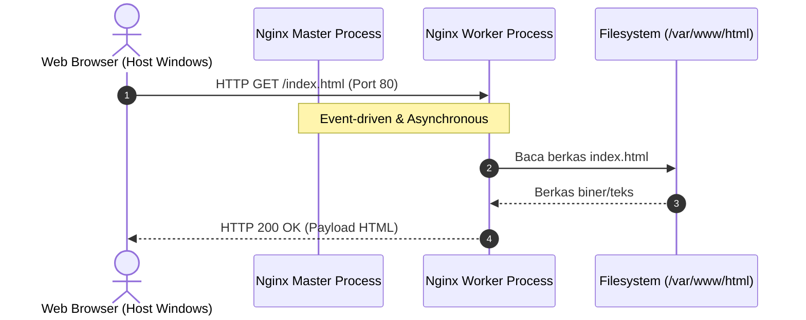
*Siklus Penanganan Permintaan HTTP pada Nginx (Sequence Diagram)*

Nginx (*Engine-X*) merupakan salah satu web server paling populer di dunia industri karena mengadopsi arsitektur *asynchronous* dan *event-driven*. Berbeda dengan web server tradisional yang membuat satu *thread/process* baru untuk setiap satu koneksi, Nginx menggunakan:
1. **Master Process:** Bertugas membaca konfigurasi, mengelola port socket, dan memonitor worker processes.
2. **Worker Process:** Menangani ribuan koneksi konkuren secara non-blocking dengan konsumsi CPU dan RAM yang sangat efisien.

Selain sebagai web server statis, Nginx juga berperan sebagai *Reverse Proxy*, *Load Balancer*, dan gerbang terminasi SSL/TLS.

#### 2.3 Windows Subsystem for Linux (WSL)
WSL merupakan fitur virtualisasi bawaan Microsoft Windows yang memungkinkan pengembang menjalankan distribusi Linux utuh (seperti Ubuntu) langsung di dalam Windows tanpa overhead berat dari hypervisor tradisional (seperti VirtualBox atau VMware). WSL2 menggunakan kernel Linux asli yang terintegrasi secara transparan dengan jaringan internal Windows, sehingga port layanan (seperti port 80 pada WSL) dapat langsung diakses melalui `localhost` pada Windows.

#### 2.4 Git Version Control
Git adalah sistem *Distributed Version Control* yang melacak setiap riwayat perubahan kode sumber. Pada tahapan dasar administrasi web server, Git digunakan untuk mengkloning (*clone*) kode proyek dari repositori online (seperti GitHub) langsung ke direktori publik server.

#### 2.5 Glosarium Perintah CLI Linux (Sintaks, Akronim, dan Fungsinya)
Tabel berikut merangkum seluruh perintah baris perintah (*Command Line Interface*) Linux yang digunakan pada modul ini, dilengkapi dengan asal-usul singkatan (*akronim*) serta deskripsi fungsinya dalam administrasi server:

**Tabel 2. Glosarium Perintah CLI Linux Modul 7**
| Perintah / Sintaks | Kepanjangan / Asal Kata (Akronim) | Deskripsi dan Fungsi Utama |
| :--- | :--- | :--- |
| `sudo` | **S**uper**u**ser **DO** | Menjalankan perintah dengan hak istimewa administratif tertinggi (*root privileges*). |
| `apt` | **A**dvanced **P**ackage **T**ool | Manajer paket utama pada Ubuntu/Debian untuk mencari, menginstal, memperbarui, dan menghapus software. |
| `apt update` | Advanced Package Tool **Update** | Memperbarui daftar katalog paket terbaru dari repositori online ke database lokal server. |
| `apt upgrade` | Advanced Package Tool **Upgrade** | Mengunduh dan menimpa paket perangkat lunak lama yang terpasang dengan versi terbaru. |
| `apt install` | Advanced Package Tool **Install** | Mengunduh paket aplikasi beserta seluruh pustaka dependensinya dari repositori resmi. |
| `cd` | **C**hange **D**irectory | Berpindah dari satu direktori kerja aktif ke direktori tujuan di dalam sistem file Linux. |
| `ls` | **L**i**S**t | Menampilkan daftar berkas dan folder yang terdapat pada direktori saat ini. |
| `ls -la` | List (**l**ong listing, **a**ll hidden) | Menampilkan detail lengkap berkas (izin akses, kepemilikan, ukuran) termasuk file tersembunyi (*dotfiles*). |
| `ip` | **I**nternet **P**rotocol | Utilitas modern untuk menampilkan konfigurasi antarmuka jaringan, routing, dan alamat IP. |
| `ip -c a` | IP (**c**olor, **a**ddress) | Menampilkan seluruh alamat IP antarmuka jaringan sistem dengan sorotan warna agar mudah dibaca. |
| `systemctl` | **SYSTEM** **C**on**T**ro**L** | Utilitas pengendali sistem inisialisasi `systemd` untuk menyalakan, mematikan, atau memonitor layanan (*service/daemon*). |
| `service` | **Service** (SysV Init Controller) | Perintah legacy pengendali daemon layanan (alternatif `systemctl` bila systemd tidak aktif di WSL). |
| `nano` | **Nano**'s ANOther editor | Editor teks berbasis terminal yang ramah pengguna untuk mengedit file konfigurasi server secara interaktif. |
| `cat` | Con**CAT**enate | Membaca dan menampilkan seluruh isi file teks langsung ke layar terminal tanpa membuka editor. |
| `mkdir` | **M**a**K**e **DIR**ectory | Membuat satu atau beberapa direktori (folder) baru pada sistem file. |
| `chown` | **CH**ange **OWN**er | Mengubah pemilik pengguna (*user*) dan grup pada suatu file atau direktori. |
| `chmod` | **CH**ange **MOD**e | Mengubah bit hak akses / izin (*permissions*) file dan folder (read, write, execute). |
| `tail` | **Tail** (Ujung Belakang) | Menampilkan baris-baris terakhir dari suatu berkas teks. |
| `tail -f` | Tail (**f**ollow) | Memantau penambahan baris baru pada file secara *real-time* (sangat berguna untuk pemantauan file log Nginx). |

---

### 3. Alat dan Kebutuhan Sistem
1. Laptop / Komputer dengan sistem operasi Windows 10 (versi 2004+) atau Windows 11.
2. Akses Terminal Windows / Command Prompt dengan hak Administrator.
3. Sambungan koneksi internet aktif untuk mengunduh paket Ubuntu dan Git repository.
4. Web Browser (Google Chrome, Microsoft Edge, atau Mozilla Firefox).

---

### 4. Langkah-Langkah Praktikum

#### a. Install WSL
1. Buka CMD di laptop masing-masing.
   
   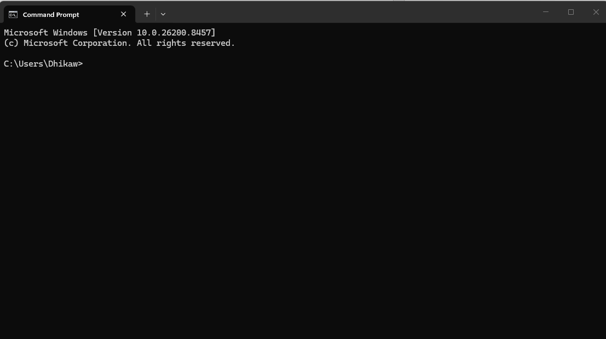
   *Gambar 2. Tampilan Command Prompt Windows.*

2. Pada CMD jalankan `wsl --install`.
   
   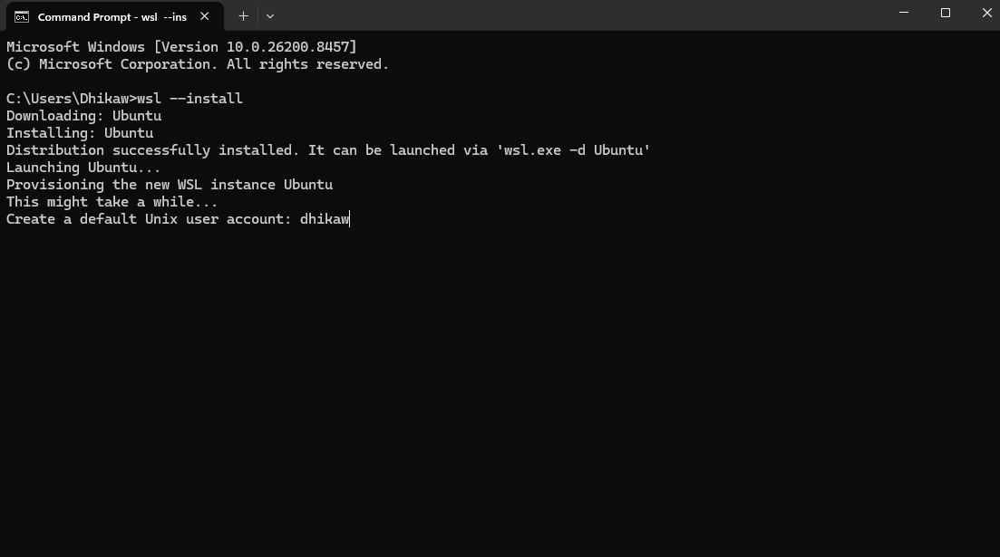
   *Gambar 3. Proses instalasi Ubuntu WSL.*

3. Setelah berhasil menginstall wsl-ubuntu, Anda akan diminta untuk membuat user dan password dari Ubuntu.
   
   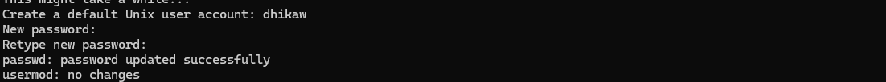
   *Gambar 4. Pembuatan akun pengguna Ubuntu.*

4. Setelah itu akan masuk langsung ke Ubuntu menandakan Ubuntu berhasil diinstal.
   
   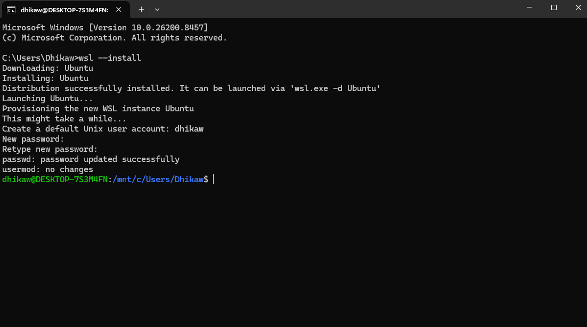
   *Gambar 5. Tampilan sesi shell terminal Ubuntu.*

#### b. Install Nginx dan Git
1. Buka Ubuntu, dan jalankan `sudo apt update && sudo apt upgrade -y` untuk memperbarui package repository Linux dalam kondisi terbaru.
   
   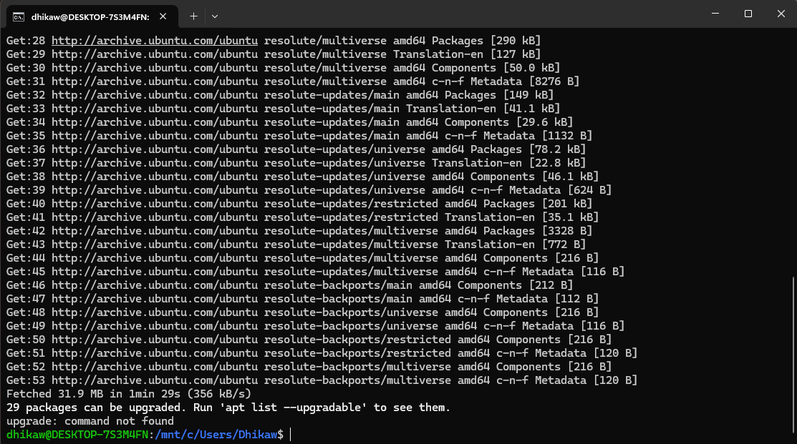
   *Gambar 6. Proses sinkronisasi repositori dan pembaruan paket.*

2. Selanjutnya jalankan `sudo apt install nginx -y` untuk melakukan install Nginx.
   
   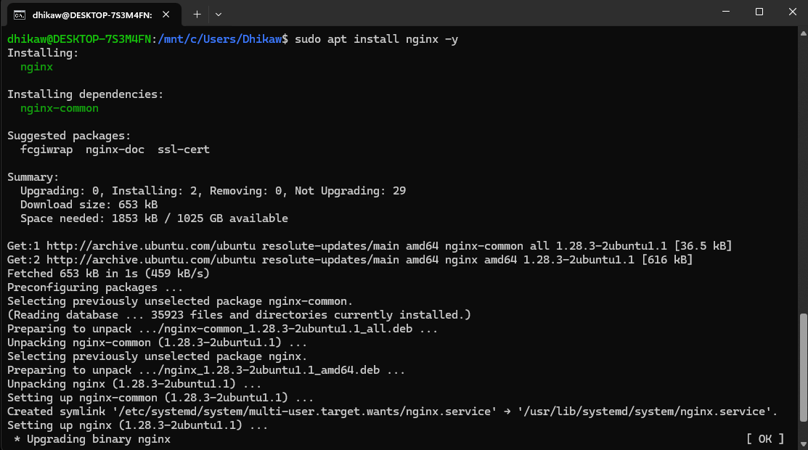
   *Gambar 7. Pemasangan paket Nginx.*

3. Setelah Nginx terinstall, jalankan service Nginx dengan `sudo service nginx start` atau `sudo systemctl start nginx`.
   
   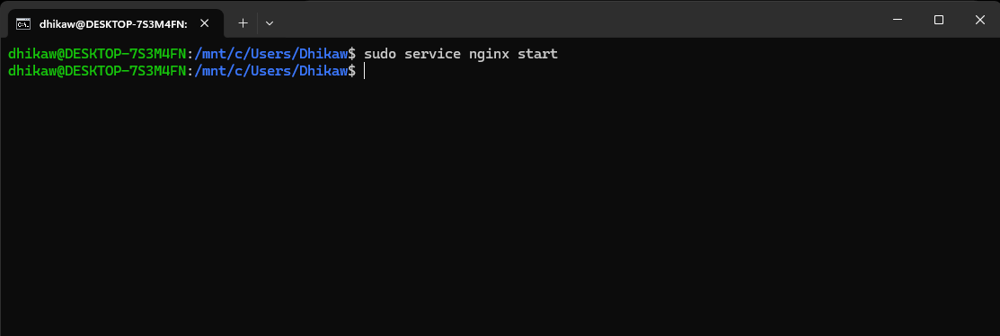
   *Gambar 8. Menjalankan service Nginx.*

4. Setelah Nginx dijalankan, cek status dari Nginx dengan `sudo systemctl status nginx` dan akan muncul indikator `active (running)`.
   
   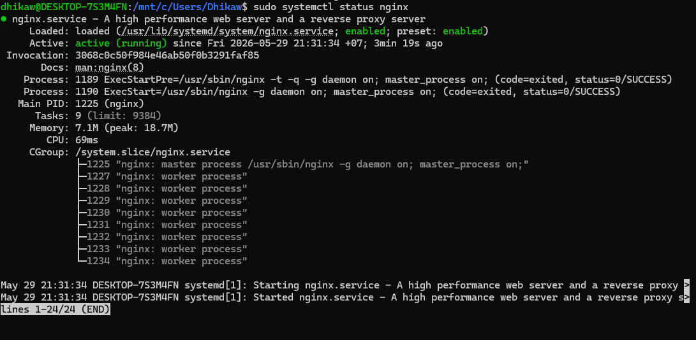
   *Gambar 9. Status operasional layanan Nginx.*

5. Untuk mengecek lebih lanjut apakah Nginx sudah berjalan, kita bisa cek melalui browser dengan IP lokal dari WSL kita. Jalankan `ip -c a` untuk mengecek IP (cek pada antarmuka `eth0`).
   
   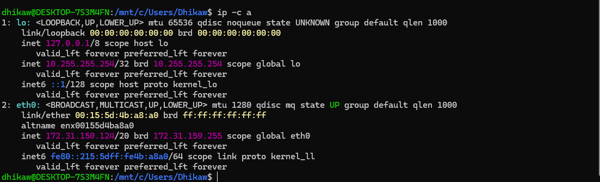
   *Gambar 10. Menampilkan alamat IP WSL.*

6. Buka peramban web di Windows dan akses `http://localhost` untuk memastikan Nginx telah melayani halaman web.
   
   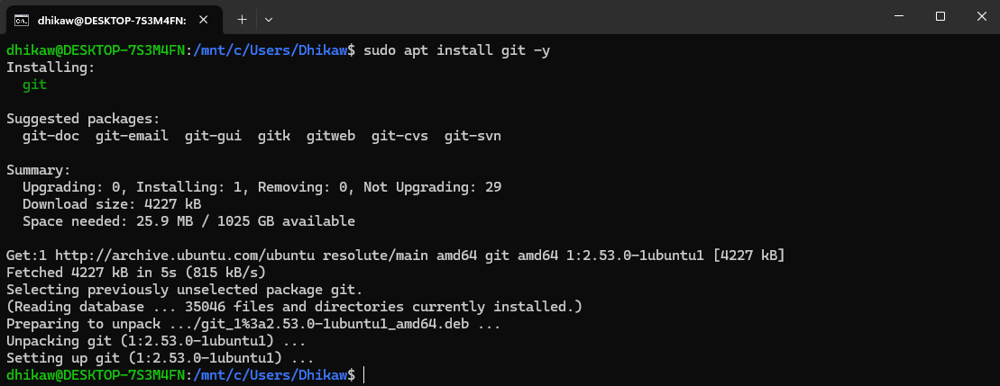
   *Gambar 11. Halaman selamat datang default Nginx.*

7. Selanjutnya install Git dengan menjalankan `sudo apt install git -y`.
   
   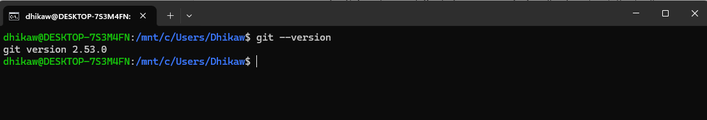
   *Gambar 12. Pemasangan Git.*

8. Cek apakah Git sudah terinstall dengan menjalankan `git --version`.

#### c. Konfigurasi Webserver
1. Konfigurasi website menggunakan HTML/CSS. Masuk ke direktori web server:
   ```bash
   cd /var/www/html
   ```
2. Unduh template website portofolio dari GitHub:
   ```bash
   sudo git clone https://github.com/faizan-ahmad5/Portfolio-responsive
   ```
   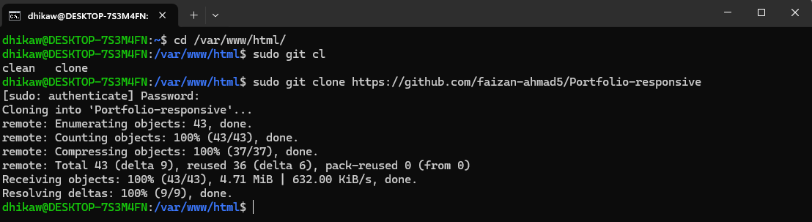
   *Gambar 13. Mengunduh source code website portofolio.*

3. Setelah berhasil terdownload, cek dengan menjalankan `ls`, folder `Portfolio-responsive` akan tampil.
   
   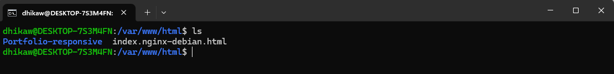
   *Gambar 14. Daftar berkas dalam /var/www/html.*

4. Masuk ke direktori konfigurasi virtual host Nginx:
   ```bash
   cd /etc/nginx/sites-available/
   ```
5. Buka file default untuk konfigurasi Nginx:
   ```bash
   sudo nano default
   ```
   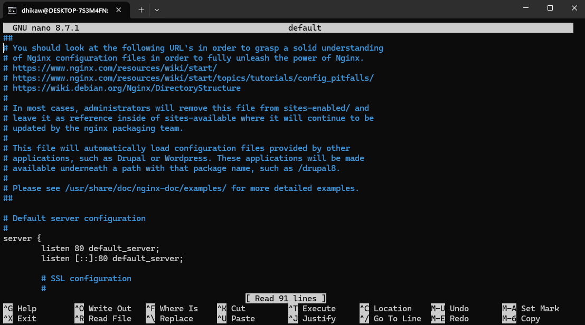
   *Gambar 15. Tampilan awal file konfigurasi default Nginx.*

6. Cari baris direktif `root /var/www/html;` yang mengatur path default document root web server.
   
   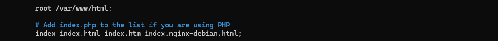
   *Gambar 16. Direktif root bawaan Nginx.*

7. Ubah direktif `root` agar mengarah ke folder proyek `Portfolio-responsive`:
   
   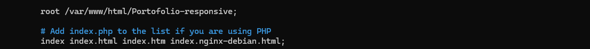
   *Gambar 17. Konfigurasi root baru mengarah ke folder portofolio.*

8. Simpan perubahan dengan menekan `Ctrl + O`, tekan `Enter`, lalu keluar dengan `Ctrl + X`.
9. Jalankan `sudo nginx -t` untuk memeriksa sintaks konfigurasi Nginx. Pastikan respon bernilai `syntax is ok` dan `test is successful`.
10. Terapkan konfigurasi baru dengan merestart Nginx:
    ```bash
    sudo systemctl restart nginx
    ```
11. Buka kembali browser di Windows pada `http://localhost`, dan website portofolio kini aktif tampil.

---

### 5. Edge Cases dan Troubleshooting

#### 1. Masalah: Web Browser Menampilkan `403 Forbidden`
* **Penyebab:** Hak akses (*file permissions*) pada folder `/var/www/html/Portfolio-responsive` tidak mengizinkan user Nginx (`www-data`) untuk membaca file `index.html`.
* **Solusi:** Berikan izin baca dan eksekusi direktori:
  ```bash
  sudo chown -R www-data:www-data /var/www/html/Portfolio-responsive
  sudo chmod -R 755 /var/www/html/Portfolio-responsive
  ```

#### 2. Masalah: Layanan Nginx Gagal Dimulai (`Address already in use :80`)
* **Penyebab:** Port 80 di Windows telah digunakan oleh aplikasi lain (seperti Apache XAMPP, Skype, atau IIS Windows).
* **Solusi:** Matikan service IIS di Windows PowerShell Administrator:
  ```powershell
  Stop-Service W3SVC
  ```
  Atau ubah port listen Nginx di `/etc/nginx/sites-available/default` menjadi port `8080`, lalu akses via `http://localhost:8080`.

#### 3. Masalah: Perintah `systemctl` Mengeluarkan Pesan Error Systemd
* **Penyebab:** Versi WSL belum mengaktifkan init systemd.
* **Solusi:** Gunakan perintah alternatif SysV:
  ```bash
  sudo service nginx restart
  sudo service nginx status
  ```

---

### 6. Tugas dan Evaluasi Praktikum
1. Buat sebuah file HTML kustom bernama `info.html` di dalam folder `/var/www/html/Portfolio-responsive/` yang berisi nama, NIM, dan identitas kelompok Anda.
2. Akses halaman tersebut melalui peramban web di `http://localhost/info.html` dan dokumentasikan hasil tangkapan layar (*screenshot*) respon HTTP-nya.
3. Tunjukkan status log akses Nginx secara *real-time* dengan menjalankan perintah `sudo tail -f /var/log/nginx/access.log` saat halaman web diakses dari browser.
