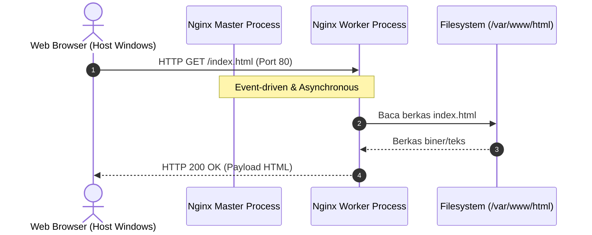

# Modul 7
## Dasar Linux dan Dasar Web Server

---

### 1. Tujuan Pembelajaran
- Memahami konsep dasar sistem operasi Linux Server dan arsitektur hierarki direktori Ubuntu.
- Memahami konsep dasar web server serta cara kerja Nginx dalam melayani request HTTP.
- Memasang dan mengonfigurasi Windows Subsystem for Linux (WSL) sebagai lingkungan server lokal.
- Menginstalasi, mengoperasikan, dan memverifikasi layanan web server Nginx pada Linux.
- Menggunakan Git dasar untuk mengunduh kode sumber website statis.
- Mengonfigurasi Virtual Host (*server block*) Nginx dan menguji akses website melalui browser host Windows (`localhost`).

---

### 2. Dasar Teori

#### 2.1 Linux Server
Linux Server adalah sistem komputer yang menggunakan sistem operasi berbasis kernel Linux untuk menyediakan berbagai layanan jaringan (*network services*), seperti web server, database server, file sharing, dan application hosting. Linux server banyak digunakan di lingkungan industri karena bersifat *open-source*, memiliki stabilitas tinggi, hemat konsumsi sumber daya, serta dilengkapi manajemen perizinan (*permissions*) yang aman.

Dalam administrasi server, pemahaman struktur direktori Linux sangat penting agar administrator mengetahui lokasi file konfigurasi, data aplikasi, serta log sistem.

**Tabel 1. Struktur Direktori Utama Ubuntu Linux**
| Direktori | Deskripsi dan Fungsi |
| :--- | :--- |
| `/` | *Root directory*, direktori tertinggi tempat seluruh file dan hierarki sistem Linux berada |
| `/home` | Menyimpan file dan data pribadi milik masing-masing pengguna (*user*) |
| `/etc` | Menyimpan seluruh file konfigurasi sistem dan layanan (termasuk Nginx) |
| `/var` | Menyimpan data dinamis yang sering berubah, seperti log sistem (`/var/log`) dan file web default (`/var/www/html`) |
| `/var/www/html` | Lokasi default *document root* penyimpanan file website pada web server |
| `/bin` | Berisi file biner program dasar Linux yang esensial untuk seluruh pengguna |
| `/usr` | Menyimpan file aplikasi, pustaka (*libraries*), dan dokumentasi tambahan pengguna |
| `/tmp` | Tempat penyimpanan file sementara yang dibersihkan secara berkala oleh sistem |
| `/boot` | Berisi file kernel Linux dan konfigurasi boot loader |
| `/dev` | Menyimpan representasi file untuk perangkat keras (*device nodes*) |
| `/proc` | Sistem file semu (*virtual filesystem*) berisi status kernel dan informasi proses |

#### 2.2 Web Server dan Nginx
Web server adalah layanan perangkat lunak yang berfungsi menerima permintaan (*request*) berbasis protokol HTTP/HTTPS dari klien (melalui peramban web seperti Chrome, Firefox, Edge), kemudian memproses dan mengirimkan berkas respons (*response*) yang diminta (seperti HTML, CSS, JavaScript, gambar, atau data JSON).


*Gambar 1. Siklus Penanganan Permintaan HTTP pada Arsitektur Nginx*

Nginx (*Engine-X*) merupakan salah satu web server paling populer di dunia industri karena mengadopsi arsitektur *asynchronous* dan *event-driven*. Berbeda dengan web server tradisional yang membuat satu *thread/process* baru untuk setiap satu koneksi, Nginx menggunakan:
1. **Master Process:** Bertugas membaca konfigurasi, mengelola port socket, dan memonitor worker processes.
2. **Worker Process:** Menangani ribuan koneksi konkuren secara non-blocking dengan konsumsi CPU dan RAM yang sangat efisien.

Selain sebagai web server statis, Nginx juga berperan sebagai *Reverse Proxy*, *Load Balancer*, dan gerbang terminasi SSL/TLS.

#### 2.3 Windows Subsystem for Linux (WSL)
WSL merupakan fitur virtualisasi bawaan Microsoft Windows yang memungkinkan pengembang menjalankan distribusi Linux utuh (seperti Ubuntu) langsung di dalam Windows tanpa overhead berat dari hypervisor tradisional (seperti VirtualBox atau VMware). WSL2 menggunakan kernel Linux asli yang terintegrasi secara transparan dengan jaringan internal Windows, sehingga port layanan (seperti port 80 pada WSL) dapat langsung diakses melalui `localhost` pada Windows.

#### 2.4 Git Version Control
Git adalah sistem *Distributed Version Control* yang melacak setiap riwayat perubahan kode sumber. Pada tahapan dasar administrasi web server, Git digunakan untuk mengkloning (*clone*) kode proyek dari repositori online (seperti GitHub) langsung ke direktori publik server.

---

### 3. Alat dan Kebutuhan Sistem
1. Laptop / Komputer dengan sistem operasi Windows 10 (versi 2004+) atau Windows 11.
2. Akses Terminal Windows / Command Prompt dengan hak Administrator.
3. Sambungan koneksi internet aktif untuk mengunduh paket Ubuntu dan Git repository.
4. Web Browser (Google Chrome, Microsoft Edge, atau Mozilla Firefox).

---

### 4. Langkah-Langkah Praktikum

#### a. Instalasi dan Persiapan WSL Ubuntu
1. Buka **Command Prompt (CMD)** atau **PowerShell** pada Windows dengan memilih **Run as administrator**.
2. Jalankan perintah instalasi WSL:
   ```cmd
   wsl --install
   ```
   *Jika WSL sudah terpasang, pastikan distribusi default adalah Ubuntu dengan perintah `wsl --install -d Ubuntu`.*
3. Setelah proses instalasi selesai, sistem akan meminta pembuatan **username** dan **password** untuk akun Ubuntu Anda.
4. Catat username dan password tersebut, karena akan digunakan saat menjalankan perintah `sudo`.
5. Anda akan langsung masuk ke sesi terminal Ubuntu Linux:
   ```text
   user@LAPTOP-NAME:~$
   ```

#### b. Instalasi Nginx dan Git
1. Perbarui daftar pustaka paket repository Ubuntu:
   ```bash
   sudo apt update && sudo apt upgrade -y
   ```
2. Pasang paket web server Nginx:
   ```bash
   sudo apt install nginx -y
   ```
3. Jalankan service Nginx:
   ```bash
   sudo service nginx start
   ```
   *Atau jika sistem mendukung systemd:*
   ```bash
   sudo systemctl start nginx
   ```
4. Verifikasi status operasional layanan Nginx:
   ```bash
   sudo systemctl status nginx
   ```
   *Pastikan terdapat indikator status berwarna hijau: `Active: active (running)`.*
5. Cek alamat IP lokal pada antarmuka jaringan WSL:
   ```bash
   ip -c a
   ```
   *Perhatikan alamat IPv4 pada baris antarmuka `eth0`.*
6. Buka web browser di Windows dan akses `http://localhost`. Halaman default bertuliskan **Welcome to nginx!** akan tampil.
7. Pasang paket Git:
   ```bash
   sudo apt install git -y
   ```
8. Periksa verifikasi versi Git yang terpasang:
   ```bash
   git --version
   ```

#### c. Deployment Website Portofolio dan Konfigurasi Nginx
1. Pindah ke direktori web server default:
   ```bash
   cd /var/www/html
   ```
2. Unduh template website portofolio dari GitHub:
   ```bash
   sudo git clone https://github.com/faizan-ahmad5/Portfolio-responsive
   ```
3. Periksa keberadaan folder hasil unduhan:
   ```bash
   ls -la
   ```
   *Folder `Portfolio-responsive` akan muncul di dalam `/var/www/html/`.*
4. Buka direktori konfigurasi situs Nginx:
   ```bash
   cd /etc/nginx/sites-available
   ls
   ```
5. Edit file konfigurasi situs default menggunakan editor `nano`:
   ```bash
   sudo nano default
   ```
6. Temukan blok direktif `root`:
   ```nginx
   # Konfigurasi Awal:
   root /var/www/html;
   index index.html index.htm index.nginx-debian.html;
   ```
7. Ubah path direktif `root` agar mengarah ke folder proyek portofolio:
   ```nginx
   # Konfigurasi Baru:
   root /var/www/html/Portfolio-responsive;
   index index.html index.htm;
   ```
8. Simpan perubahan dengan menekan `Ctrl + O`, tekan `Enter`, lalu keluar dengan `Ctrl + X`.
9. Uji keabsahan sintaks konfigurasi Nginx:
   ```bash
   sudo nginx -t
   ```
   *Pastikan muncul pesan `syntax is ok` dan `test is successful`.*
10. Muat ulang layanan Nginx agar konfigurasi baru aktif:
    ```bash
    sudo systemctl restart nginx
    ```
11. Buka kembali browser di Windows, bersihkan cache dengan menekan `Ctrl + F5`, dan akses `http://localhost`. Tampilan website portofolio kini aktif.

---

### 5. Edge Cases dan Troubleshooting

#### 1. Masalah: Web Browser Menampilkan `403 Forbidden`
* **Penyebab:** Hak akses (*file permissions*) pada folder `/var/www/html/Portfolio-responsive` tidak mengizinkan user Nginx (`www-data`) untuk membaca file `index.html`.
* **Solusi:** Berikan izin baca dan eksekusi direktori:
  ```bash
  sudo chown -R www-data:www-data /var/www/html/Portfolio-responsive
  sudo chmod -R 755 /var/www/html/Portfolio-responsive
  ```

#### 2. Masalah: Layanan Nginx Gagal Dimulai (`Address already in use :80`)
* **Penyebab:** Port 80 di Windows telah digunakan oleh aplikasi lain (seperti Apache XAMPP, Skype, atau IIS Windows).
* **Solusi:** Matikan service IIS di Windows PowerShell Administrator:
  ```powershell
  Stop-Service W3SVC
  ```
  Atau ubah port listen Nginx di `/etc/nginx/sites-available/default` menjadi port `8080`, lalu akses via `http://localhost:8080`.

#### 3. Masalah: Perintah `systemctl` Mengeluarkan Pesan Error Systemd
* **Penyebab:** Versi WSL belum mengaktifkan init systemd.
* **Solusi:** Gunakan perintah alternatif SysV:
  ```bash
  sudo service nginx restart
  sudo service nginx status
  ```

---

### 6. Tugas dan Evaluasi Praktikum
1. Buat sebuah file HTML kustom bernama `info.html` di dalam folder `/var/www/html/Portfolio-responsive/` yang berisi nama, NIM, dan identitas kelompok Anda.
2. Akses halaman tersebut melalui peramban web di `http://localhost/info.html` dan dokumentasikan hasil tangkapan layar (*screenshot*) respon HTTP-nya.
3. Tunjukkan status log akses Nginx secara *real-time* dengan menjalankan perintah `sudo tail -f /var/log/nginx/access.log` saat halaman web diakses dari browser.
