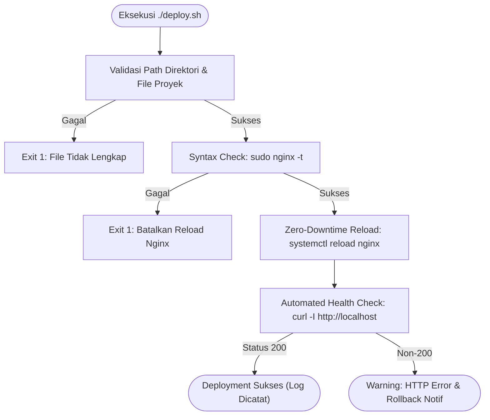

# Modul 8
## Otomasi Git Workflow dan Shell Scripting Deployment

---

### 1. Tujuan Pembelajaran
- Memahami konsep version control workflow dan siklus otomatisasi deployment dalam prinsip DevOps.
- Mengelola repositori Git lokal dan alur kerja staging-commit untuk versioning aplikasi web.
- Menyusun skrip shell bash yang dilengkapi mekanisme *defensive error handling* dan validasi otomatis.
- Mengonfigurasi hak akses Linux (*file permissions*) untuk file eksekusi dan direktori web server.
- Mengotomasi verifikasi operasional web server Nginx menggunakan *HTTP health check* berbasis `curl`.
- Mendiagnosis dan menangani kendala teknis (*edge cases*) yang umum terjadi di lingkungan server Linux/WSL.

---

### 2. Dasar Teori

#### 2.1 Konsep DevOps: Manual vs. Automated Deployment
Dalam arsitektur pengelolaan server tradisional, pembaruan aplikasi dilakukan secara manual melalui serangkaian perintah CLI: mengunduh perubahan, memeriksa syntax konfigurasi, memindahkan file, hingga me-restart service web server. Pendekatan ini memiliki sejumlah kelemahan:
1. **Human Error:** Kesalahan pengetikan perintah atau lupa menguji syntax konfigurasi dapat menyebabkan kegagalan layanan (*service outage*).
2. **Inkonsistensi:** Langkah yang dijalankan oleh satu administrator dapat berbeda dengan administrator lainnya.
3. **Downtime yang Tidak Perlu:** Menjalankan perintah `restart` secara langsung akan memutus koneksi pengguna aktif, berbeda dengan `reload` yang mempertahankan koneksi yang sedang berjalan sembari memuat konfigurasi baru secara mulus (*zero-downtime reload*).

Otomasi deployment menyelesaikan masalah ini dengan mengemas seluruh langkah operasional ke dalam satu skrip instruksi yang teruji, deterministik, dan dapat diulang (*repeatable*).


*Gambar 1. Siklus Eksekusi Skrip Otomasi Deployment dengan Defensive Error Handling*

#### 2.2 Siklus Version Control dengan Git
Git bekerja dengan melacak perubahan pada tiga area utama sebelum sebuah kode tercatat secara permanen:
1. **Working Directory:** Direktori tempat file proyek diedit secara langsung oleh pengembang.
2. **Staging Area (Index):** Area penampungan sementara untuk memilih perubahan mana saja yang akan dimasukkan ke dalam commit berikutnya melalui perintah `git add`.
3. **Repository (.git):** Basis data lokal tempat seluruh rekaman riwayat snapshot kode disimpan secara permanen melalui perintah `git commit`.

**Tabel 1. Perintah Inti Git Workflow**
| Perintah | Area Kerja | Deskripsi Fungsi |
| :--- | :--- | :--- |
| `git init` | Working Dir | Membuat repositori lokal baru pada direktori aktif |
| `git status` | Working Dir / Staging | Mengetahui status modifikasi file dan kesiapan commit |
| `git add <nama_file>` | Staging Area | Memasukkan perubahan file ke dalam daftar siap commit |
| `git commit -m "pesan"` | Repository | Mengunci snapshot perubahan dengan pesan identifikasi |
| `git log --oneline` | Repository | Menampilkan daftar commit dalam format satu baris per versi |
| `git diff` | Working Dir | Menampilkan detail baris kode yang ditambahkan atau diubah |

#### 2.3 Hak Akses Linux dan Eksekusi Shell Script
Di dalam sistem operasi berbasis UNIX/Linux, setiap file dan direktori memiliki tabel izin akses yang terbagi menjadi tiga kategori entitas:
- **User (u):** Akun pemilik file.
- **Group (g):** Grup pengguna yang memiliki file tersebut.
- **Others (o):** Semua pengguna lain di dalam sistem.

**Tabel 2. Matriks Notasi Izin File Linux**
| Kategori Izin | Simbol | Nilai Oktal | Efek pada File | Efek pada Direktori |
| :---: | :---: | :---: | :--- | :--- |
| Read | `r` | 4 | Membaca isi file | Melihat daftar isi folder (`ls`) |
| Write | `w` | 2 | Mengedit isi file | Menambah/menghapus file di folder |
| Execute | `x` | 1 | Menjalankan file sebagai program | Masuk ke direktori (`cd`) |

Skrip bash membutuhkan atribut `x` (eksekusi) agar dapat dipanggil secara langsung menggunakan path `./nama_skrip.sh`. Tanpa atribut tersebut, shell akan menolak eksekusi dengan pesan kesalahan `Permission denied`.

---

### 3. Alat dan Kebutuhan Praktikum
1. Perangkat komputer dengan sistem operasi Windows 10/11.
2. WSL2 Ubuntu yang telah terpasang paket `nginx`, `git`, dan `curl`.
3. Teks editor nano atau Visual Studio Code dengan ekstensi *WSL Remote*.
4. Akses akun pengguna dengan hak istimewa `sudo`.

---

### 4. Langkah-Langkah Konfigurasi & Praktikum

#### 4.1 Inisialisasi Proyek dan Pengaturan Repositori Git
1. Buka terminal Ubuntu WSL.
2. Navigasi ke direktori *home* pengguna dan buat workspace proyek:
   ```bash
   cd ~
   mkdir -p ~/web-devops && cd ~/web-devops
   ```
3. Inisialisasi Git repositori lokal:
   ```bash
   git init
   ```
4. Tetapkan konfigurasi identitas pengembang lokal:
   ```bash
   git config user.name "Praktikan DevOps"
   git config user.email "praktikan@lab.local"
   ```
5. Buat file `index.html` sebagai artefak aplikasi web:
   ```bash
   cat << 'EOF' > index.html
   <!DOCTYPE html>
   <html lang="id">
   <head>
       <meta charset="UTF-8">
       <meta name="viewport" content="width=device-width, initial-scale=1.0">
       <title>DevOps Training Lab</title>
       <style>
           body { font-family: -apple-system, BlinkMacSystemFont, "Segoe UI", Roboto, sans-serif; background-color: #0f172a; color: #f8fafc; text-align: center; padding-top: 80px; }
           .container { background: #1e293b; display: inline-block; padding: 40px; border-radius: 12px; box-shadow: 0 10px 25px rgba(0,0,0,0.4); border: 1px solid #334155; }
           h1 { margin-bottom: 8px; color: #38bdf8; }
           .version-badge { background-color: #0284c7; color: white; padding: 6px 14px; border-radius: 20px; font-weight: 600; font-size: 0.9rem; }
           .status-box { margin-top: 25px; padding: 12px; background: #0f172a; border-radius: 8px; font-family: monospace; font-size: 0.85rem; color: #4ade80; border: 1px solid #1e293b; }
       </style>
   </head>
   <body>
       <div class="container">
           <h1>Platform Server Pelatihan Internal</h1>
           <p>Modul 8: Otomasi Git & Shell Scripting</p>
           <p><span class="version-badge">Rilis: Versi 1.0.0 (Manual)</span></p>
           <div class="status-box">Status Web Server: Berjalan Normal</div>
       </div>
   </body>
   </html>
   EOF
   ```
6. Simpan file tersebut ke dalam pencatatan versi Git:
   ```bash
   git add index.html
   git commit -m "feat: inisialisasi source code website rilis v1.0.0"
   ```

#### 4.2 Integrasi Nginx Virtual Host ke Direktori Proyek
1. Buka file konfigurasi blok server Nginx:
   ```bash
   sudo nano /etc/nginx/sites-available/default
   ```
2. Temukan baris direktif `root` dan sesuaikan dengan path absolut repositori praktikan:
   ```nginx
   # Sesuaikan username dengan user WSL aktif Anda
   root /home/<username_anda>/web-devops;
   index index.html index.htm;
   ```
3. Keluar dan simpan perubahan (`Ctrl + O`, `Enter`, `Ctrl + X`).
4. Atur hak akses direktori induk agar Nginx (user sistem `www-data`) memiliki izin membaca file:
   ```bash
   chmod 755 $HOME
   chmod -R 755 $HOME/web-devops
   ```
5. Lakukan uji validasi sintaks konfigurasi Nginx:
   ```bash
   sudo nginx -t
   ```
   *Pastikan terminal menampilkan respon sukses: `syntax is ok` dan `test is successful`.*
6. Jalankan pembaruan konfigurasi web server:
   ```bash
   sudo systemctl reload nginx
   ```
7. Buka browser pada Windows, ketik alamat `http://localhost`, dan verifikasi bahwa halaman web versi 1.0.0 berhasil dirender.

#### 4.3 Pembuatan Skrip Otomasi Deployment (`deploy.sh`)
1. Buat file `deploy.sh` pada direktori root proyek:
   ```bash
   nano deploy.sh
   ```
2. Tuliskan kode otomasi berikut:
   ```bash
   #!/bin/bash
   # ==============================================================================
   # MODUL 8: AUTOMATED DEPLOYMENT & HEALTH CHECK SCRIPT
   # ==============================================================================
   set -eo pipefail

   PROJECT_DIR="$(cd "$(dirname "${BASH_SOURCE[0]}")" && pwd)"
   LOG_FILE="$PROJECT_DIR/deployment.log"
   TIMESTAMP=$(date "+%Y-%m-%d %H:%M:%S")

   log_message() {
       echo "[$TIMESTAMP] $1" | tee -a "$LOG_FILE"
   }

   echo "======================================================"
   echo "    MEMULAI SIKLUS OTOMASI DEPLOYMENT APLIKASI WEB    "
   echo "======================================================"

   # 1. Validasi Keberadaan Direktori dan File Kunci
   cd "$PROJECT_DIR"
   if [ ! -f "index.html" ]; then
       log_message "[FATAL] File index.html tidak ditemukan pada $PROJECT_DIR. Deployment dibatalkan!"
       exit 1
   fi
   log_message "[INFO] Integritas file proyek valid."

   # 2. Verifikasi Hak Akses File Web
   chmod 644 "$PROJECT_DIR"/index.html
   log_message "[INFO] Penyesuaian file permission selesai."

   # 3. Uji Sintaks Konfigurasi Nginx
   echo "[INFO] Menjalankan uji sintaks Nginx (nginx -t)..."
   if ! sudo nginx -t > /dev/null 2>&1; then
       log_message "[FATAL] Sintaks Nginx tidak valid! Silakan periksa file konfigurasi."
       exit 1
   fi
   log_message "[INFO] Konfigurasi Nginx terverifikasi valid."

   # 4. Zero-Downtime Reload Service Web Server
   echo "[INFO] Menerapkan konfigurasi baru ke Nginx..."
   if sudo systemctl reload nginx; then
       log_message "[INFO] Service Nginx berhasil dimuat ulang (reload)."
   else
       log_message "[FATAL] Gagal me-reload Nginx!"
       exit 1
   fi

   # 5. Automated Health Check Menggunakan cURL
   echo "[INFO] Melakukan HTTP Health Check ke endpoint lokal..."
   HTTP_CODE=$(curl -s -o /dev/null -w "%{http_code}" http://localhost/ || echo "000")

   if [ "$HTTP_CODE" -eq 200 ]; then
       COMMIT_HASH=$(git rev-parse --short HEAD 2>/dev/null || echo "non-git")
       log_message "[SUCCESS] Deployment Berhasil! Status HTTP: $HTTP_CODE | Git Commit: $COMMIT_HASH"
       echo "======================================================"
       echo " APLIKASI BERHASIL DIRELOAD & BERJALAN DI http://localhost "
       echo "======================================================"
   else
       log_message "[ERROR] Health check gagal! Mendapatkan HTTP Code: $HTTP_CODE (Ekspektasi: 200)"
       echo "======================================================"
       echo " [PERINGATAN] Endpoint tidak mengembalikan status 200 OK!"
       echo "======================================================"
       exit 1
   fi
   ```
3. Simpan file (`Ctrl + O`, `Enter`, `Ctrl + X`).
4. Berikan izin eksekusi pada skrip:
   ```bash
   chmod +x deploy.sh
   ```

#### 4.4 Pengujian Pembaruan Aplikasi (Release Simulation)
1. Modifikasi file `index.html` untuk mensimulasikan rilis aplikasi versi 2.0.0:
   ```bash
   sed -i 's/Rilis: Versi 1.0.0 (Manual)/Rilis: Versi 2.0.0 (Automated Script)/g' index.html
   ```
2. Rekam perubahan ke dalam repositori Git:
   ```bash
   git add index.html
   git commit -m "release: pembaruan aplikasi ke versi 2.0.0"
   ```
3. Jalankan skrip deployment otomatis:
   ```bash
   ./deploy.sh
   ```
4. Periksa file riwayat log yang dihasilkan:
   ```bash
   cat deployment.log
   ```
5. Akses kembali browser Windows di `http://localhost` (tekan `Ctrl + F5` untuk membersihkan cache). Halaman web langsung diperbarui ke Versi 2.0.0.

---

### 5. Edge Cases dan Penanganannya (Troubleshooting Guide)

#### 1. Masalah: Error `403 Forbidden` Saat Mengakses Website
* **Gejala:** Browser menampilkan pesan kesalahan `403 Forbidden` dari Nginx saat membuka `http://localhost`.
* **Akar Masalah:** Nginx dijalankan oleh user sistem bernama `www-data`. Secara default di Linux, direktori *home* pengguna (`/home/<username>`) memiliki permission `700` atau `750`. Hal ini mencegah user `www-data` membaca isi folder proyek yang berada di dalam folder home tersebut.
* **Solusi Penanganan:**
  Tambahkan izin pembacaan dan penelusuran direktori untuk kategori *Others*:
  ```bash
  chmod 755 /home/$(whoami)
  chmod -R 755 /home/$(whoami)/web-devops
  ```

#### 2. Masalah: Systemd Tidak Aktif di WSL (`System has not been booted with systemd as init system`)
* **Gejala:** Perintah `sudo systemctl reload nginx` menghasilkan pesan kegagalan:
  `System has not been booted with systemd as init system (PID 1). Can't operate.`
* **Akar Masalah:** Distribusi WSL versi lama tidak mengaktifkan `systemd` secara default dan masih menggunakan init SysV tradisional.
* **Solusi Penanganan:**
  1. *Opsi A (Aktifkan Systemd di WSL2 - Direkomendasikan):*  
     Buka file konfigurasi WSL:
     ```bash
     sudo nano /etc/wsl.conf
     ```
     Tambahkan baris berikut:
     ```ini
     [boot]
     systemd=true
     ```
     Buka PowerShell di Windows dan restart WSL:
     ```powershell
     wsl --shutdown
     ```
     Buka kembali terminal Ubuntu Anda.
  2. *Opsi B (Fallback Command):*  
     Gunakan perintah SysV langsung di dalam skrip jika systemd tidak tersedia:
     ```bash
     sudo service nginx reload
     ```

#### 3. Masalah: Error `Permission denied` Saat Menjalankan `./deploy.sh`
* **Gejala:** Terminal menolak mengeksekusi skrip dengan output `-bash: ./deploy.sh: Permission denied`.
* **Akar Masalah:** File skrip baru dibuat tanpa atribut izin eksekusi (`x`).
* **Solusi Penanganan:**
  Periksa status izin file dengan `ls -l deploy.sh`. Tambahkan atribut eksekusi:
  ```bash
  chmod +x deploy.sh
  ```

#### 4. Masalah: Error Karakter Windows End-of-Line (`\r: command not found`)
* **Gejala:** Skrip gagal dijalankan dengan pesan error seperti `deploy.sh: line 2: $'\r': command not found`.
* **Akar Masalah:** File skrip dibuat atau diedit menggunakan editor berbasis Windows (seperti Notepad biasa) yang menggunakan format baris teks CRLF (`\r\n`), sedangkan Linux hanya mengenali format LF (`\n`).
* **Solusi Penanganan:**
  Konversikan format teks ke Linux menggunakan utility `dos2unix`:
  ```bash
  sudo apt install dos2unix -y
  dos2unix deploy.sh
  ```

#### 5. Masalah: Konflik Port 80 dengan Layanan Windows (Port Binding Conflict)
* **Gejala:** Service Nginx gagal berjalan (`Address already in use` pada port 80).
* **Akar Masalah:** Port 80 pada sistem Windows telah digunakan oleh layanan bawaan Windows seperti *World Wide Web Publishing Service (IIS)*, *Skype*, atau layanan *SQL Server Reporting Services*.
* **Solusi Penanganan:**
  1. Matikan service IIS di Windows via PowerShell (Administrator):
     ```powershell
     Stop-Service W3SVC
     ```
  2. *Atau* ubah port listen Nginx di WSL menjadi port non-standar (misalnya port 8080):
     Buka `/etc/nginx/sites-available/default`, ubah baris:
     ```nginx
     listen 8080 default_server;
     listen [::]:8080 default_server;
     ```
     Lalu akses di browser melalui `http://localhost:8080`.

#### 6. Masalah: Kegagalan Deployment Karena Syntax Nginx Rusak
* **Gejala:** File konfigurasi Nginx mengalami salah ketik (*typo*), misalnya titik koma (`;`) hilang.
* **Akar Masalah:** Administrator melakukan modifikasi konfigurasi tanpa validasi terlebih dahulu.
* **Solusi Penanganan:**
  Skrip `deploy.sh` telah dilengkapi dengan baris pencegah:
  ```bash
  if ! sudo nginx -t > /dev/null 2>&1; then ... exit 1; fi
  ```
  Mekanisme ini mencegah perintah `systemctl reload nginx` dieksekusi ketika konfigurasi rusak, sehingga web server yang sedang berjalan di memori tetap melayani pengunjung tanpa mengalami *crash* atau *downtime*.

---

### 6. Tugas dan Evaluasi Praktikum
1. **Penerapan Fitur Rollback Otomatis:**  
   Modifikasi skrip `deploy.sh` agar ketika *Automated Health Check* mendeteksi HTTP Code selain `200`, skrip secara otomatis menjalankan `git checkout HEAD~1 index.html` (mengembalikan kode ke commit sebelumnya) dan melakukan reload ulang Nginx.
2. **Pencatatan Audit Log:**  
   Tunjukkan isi file `deployment.log` Anda setelah melakukan sedikitnya 3 kali commit perubahan dan deployment secara berurutan.
