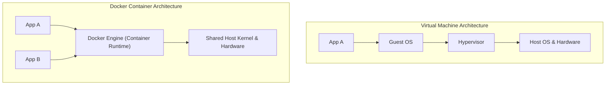
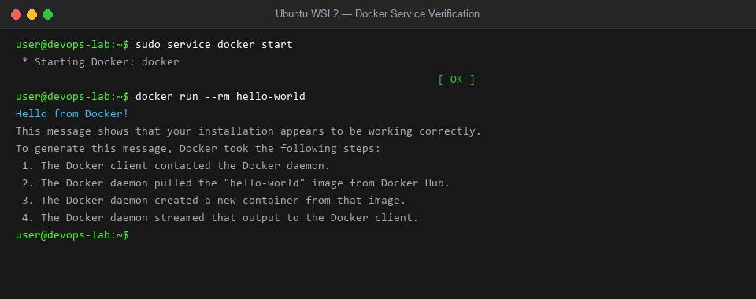
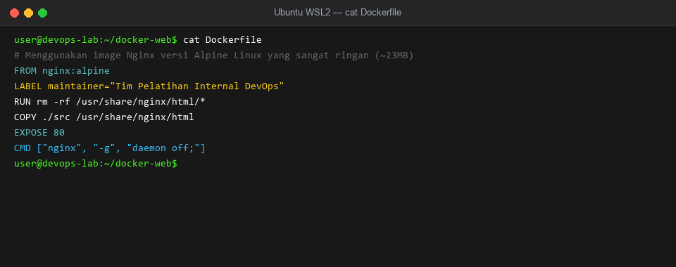
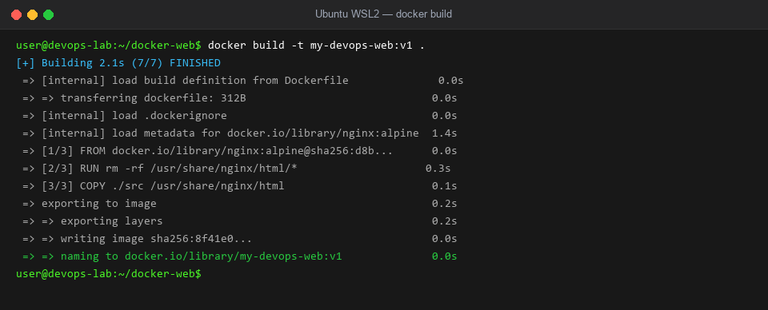
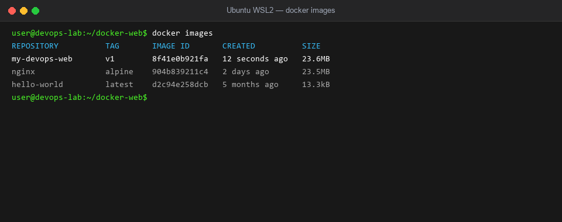
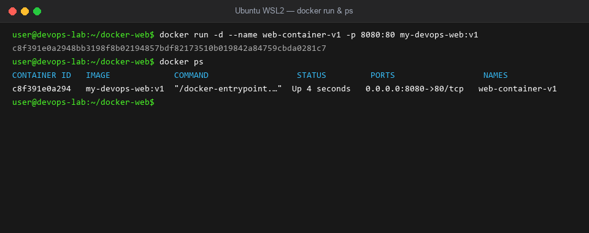
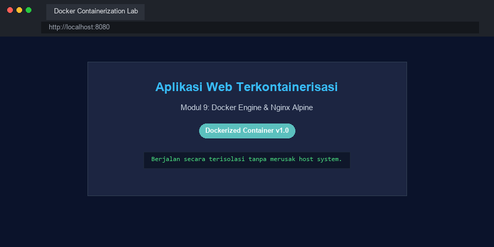
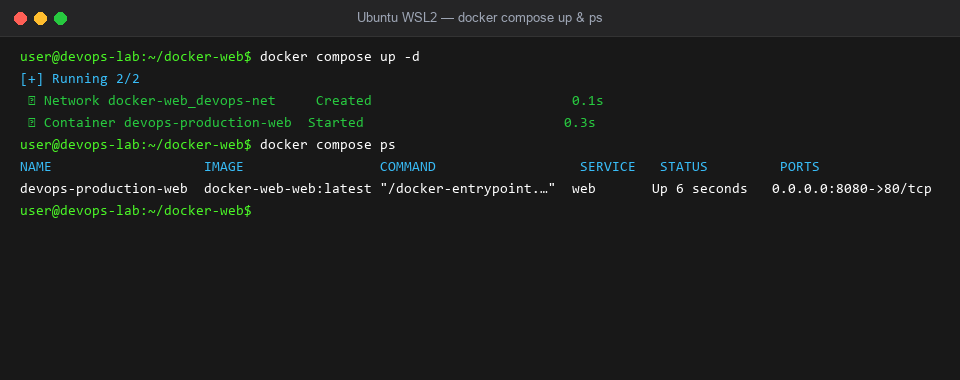
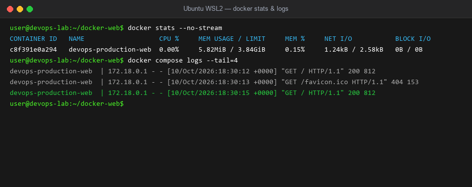

# Modul 9
## Containerization dengan Docker dan Docker Compose

---

### 1. Tujuan Pembelajaran
- Memahami konsep dasar kontainerisasi dan perbedaannya dengan Virtual Machine serta WSL.
- Menguasai anatomi komponen Docker: Docker Engine, Image, Container, Registry, dan Volume.
- Menulis dan mengoptimalkan `Dockerfile` berbasis image minimalis (`nginx:alpine`).
- Mengoperasikan perintah Docker CLI untuk siklus hidup kontainer (*build, run, logs, exec, stop, rm*).
- Mengimplementasikan konsep *Port Mapping* dan *Bind Mount Volume* untuk *live-reload development*.
- Mengorkestrasi aplikasi multi-layanan menggunakan `docker-compose.yml`.
- Mendiagnosis dan menangani kendala teknis (*edge cases*) operasional Docker di lingkungan WSL2.

---

### 2. Dasar Teori

#### 2.1 Konsep Kontainerisasi vs Virtual Machine
Sebelum teknologi kontainer populer, pemisahan lingkungan aplikasi mengandalkan Virtual Machine (VM) yang memerlukan Hypervisor dan satu sistem operasi tamu (*Guest OS*) utuh untuk setiap aplikasi. Pendekatan ini memakan ruang disk yang besar, konsumsi RAM yang tinggi, serta waktu booting yang lambat.

Docker memanfaatkan fitur kernel Linux bawaan (*Control Groups/cgroups* dan *Namespaces*) untuk mengisolasi proses aplikasi secara langsung pada tingkat sistem operasi host tanpa memerlukan Guest OS tambahan.


*Gambar 1. Perbandingan Arsitektur Virtual Machine vs Docker Container*

**Tabel 1. Perbandingan VM vs Docker Container**
| Parameter | Virtual Machine (VM) | Docker Container |
| :--- | :--- | :--- |
| **Arsitektur** | Membawa Guest OS sendiri di atas hypervisor | Berbagi kernel Linux host secara langsung |
| **Waktu Booting** | Hitungan menit | Hitungan detik atau milidetik |
| **Penggunaan Resource** | Berat (membutuhkan alokasi RAM & CPU permanen) | Ringan (hanya menggunakan sumber daya yang dibutuhkan) |
| **Ukuran Image** | Gigabyte (GB) | Megabyte (MB) (misal `alpine` ~5MB) |
| **Portabilitas** | Terikat pada format hypervisor | Universal (*Build Once, Run Anywhere*) |

#### 2.2 Anatomi Komponen Docker
1. **Dockerfile:** Berkas resep teks instruksi untuk membangun sebuah image secara terotomasi.
2. **Docker Image:** Template berkas *read-only* yang memaketkan source code, dependensi pustaka, dan konfigurasi runtime aplikasi.
3. **Docker Container:** Instansiasi aktif dan dapat dijalankan (*executable instance*) dari sebuah Docker Image.
4. **Volume:** Mekanisme penyimpanan persisten yang memisahkan data penting dari siklus hidup kontainer yang *stateless*.
5. **Docker Compose:** Alat bantu deklaratif (format YAML) untuk mendefinisikan dan menjalankan arsitektur multi-kontainer secara terkoordinasi.

**Tabel 2. Instruksi Inti dalam Dockerfile**
| Perintah | Deskripsi Fungsi |
| :--- | :--- |
| `FROM <image>` | Menentukan basis image yang digunakan (misal: `nginx:alpine`) |
| `WORKDIR <path>` | Menetapkan direktori kerja aktif di dalam kontainer |
| `COPY <src> <dest>` | Menyalin file dari sistem host ke dalam filesystem image |
| `EXPOSE <port>` | Memberi dokumentasi port jaringan yang dibuka oleh kontainer |
| `ENV <key>=<val>` | Menetapkan variabel lingkungan (*environment variables*) |
| `CMD ["exec", "param"]` | Perintah default yang dieksekusi saat kontainer pertama kali menyala |

#### 2.3 Glosarium Perintah CLI Docker dan Linux Sistem (Sintaks, Akronim, dan Fungsinya)
Tabel berikut menjelaskan rincian sintaks perintah baris perintah Docker dan administrasi sistem yang digunakan pada modul ini beserta kepanjangan dan fungsinya:

**Tabel 3. Glosarium Perintah CLI Docker & Linux Modul 9**
| Perintah / Sintaks | Kepanjangan / Asal Kata (Akronim) | Deskripsi dan Fungsi Utama |
| :--- | :--- | :--- |
| `docker` | Dari istilah *dock worker* (pekerja peti kemas pelabuhan) | Platform utama untuk memaketkan, mendistribusikan, dan mengisolasi aplikasi dalam kontainer. |
| `docker build` | Docker **Build** Image | Membaca berkas `Dockerfile` untuk merakit dan menyusun layer Docker Image baru. |
| `docker run` | Docker **Run** Container | Membuat dan langsung menjalankan instance kontainer baru dari sebuah image tertentu. |
| `docker run -d` | Docker Run (**d**etached) | Menjalankan kontainer di latar belakang (*background mode*) sehingga terminal tetap bebas digunakan. |
| `docker run -p 8080:80` | Docker Run (**p**ort publish / port mapping) | Meneruskan lalu lintas dari port 8080 host ke port 80 internal kontainer. |
| `docker run -v` | Docker Run (**v**olume / bind mount) | Menghubungkan direktori fisik host ke direktori di dalam kontainer untuk sinkronisasi data/kode. |
| `docker ps` | Docker **P**rocess **S**tatus | Menampilkan daftar seluruh kontainer yang saat ini sedang aktif berjalan. |
| `docker ps -a` | Docker Process Status (**a**ll) | Menampilkan seluruh kontainer di sistem, termasuk yang statusnya sudah berhenti (*exited*). |
| `docker images` | Docker **Images** | Menampilkan daftar seluruh template image yang telah diunduh atau dibuat di mesin lokal. |
| `docker stop` | Docker **Stop** | Mengirim sinyal `SIGTERM` untuk menghentikan proses kontainer secara tertib (*graceful shutdown*). |
| `docker rm` | Docker **R**e**M**ove | Menghapus satu atau lebih kontainer yang sudah tidak aktif dari disk host. |
| `docker rmi` | Docker **R**e**M**ove **I**mage | Menghapus satu atau lebih image lokal dari penyimpanan Docker. |
| `docker exec` | Docker **EXEC**ute | Menjalankan perintah baru di dalam kontainer yang sedang berjalan (contoh: membuka shell interaktif `sh`). |
| `docker exec -it` | Docker Execute (**i**nteractive, **t**ty) | Membuka sesi pseudo-terminal interaktif langsung ke dalam lingkungan kontainer. |
| `docker logs` | Docker **Logs** | Mengambil output standar (*stdout/stderr*) yang dicetak oleh aplikasi di dalam kontainer. |
| `docker stats` | Docker **Stat**istics | Menampilkan konsumsi CPU, memori (RAM), dan network I/O kontainer secara *real-time*. |
| `docker top` | Docker **Top** (Process Table) | Menampilkan daftar proses sistem operasi yang sedang berjalan di dalam kontainer aktif. |
| `docker compose up -d` | Docker Compose **Up** (Detached) | Membangun jaringan, volume, dan menyalakan seluruh layanan multi-kontainer sesuai deklarasi YAML. |
| `docker compose down` | Docker Compose **Down** | Menghentikan dan membersihkan seluruh kontainer, jaringan, dan resource yang dibuat oleh Compose. |
| `usermod` | **USER** **MOD**ify | Perintah Linux untuk memodifikasi pengaturan akun pengguna (seperti menambahkan grup `docker`). |
| `newgrp` | **NEW** **GR**ou**P** | Memperbarui sesi shell yang sedang aktif agar mengenali keanggotaan grup pengguna yang baru ditambahkan. |

---

### 3. Alat dan Kebutuhan Praktikum
1. Perangkat komputer Windows 10/11 dengan WSL2 Ubuntu terpasang.
2. Docker Engine terpasang di WSL2 *atau* Docker Desktop for Windows yang terintegrasi ke WSL2.
3. Web Browser (Chrome/Firefox/Edge) dan terminal Ubuntu WSL.
4. Teks editor (nano atau Visual Studio Code).

---

### 4. Langkah-Langkah Praktikum

#### 4.1 Instalasi Docker Engine di Ubuntu WSL2
1. Buka terminal Ubuntu WSL.
2. Hapus instalasi paket docker lawas jika ada:
   ```bash
   sudo apt-get remove docker docker-engine docker.io containerd runc -y || true
   ```
3. Pasang paket dependensi resmi:
   ```bash
   sudo apt update
   sudo apt install -y ca-certificates curl gnupg lsb-release
   ```
4. Tambahkan Docker official GPG key dan repository:
   ```bash
   sudo mkdir -p /etc/apt/keyrings
   curl -fsSL https://download.docker.com/linux/ubuntu/gpg | sudo gpg --dearmor -o /etc/apt/keyrings/docker.gpg --yes
   echo \
     "deb [arch=$(dpkg --print-architecture) signed-by=/etc/apt/keyrings/docker.gpg] https://download.docker.com/linux/ubuntu \
     $(lsb_release -cs) stable" | sudo tee /etc/apt/sources.list.d/docker.list > /dev/null
   ```
5. Pasang Docker Engine dan Docker Compose:
   ```bash
   sudo apt update
   sudo apt install -y docker-ce docker-ce-cli containerd.io docker-compose-plugin
   ```
6. Tambahkan pengguna aktif ke grup `docker` agar dapat menjalankan docker tanpa `sudo`:
   ```bash
   sudo usermod -aG docker $USER
   ```
7. Mulai service Docker daemon:
   ```bash
   sudo service docker start
   ```
8. Verifikasi status Docker dengan menjalankan kontainer uji:
   ```bash
   docker run --rm hello-world
   ```
   
   *Gambar 2. Output verifikasi instalasi Docker Engine berhasil.*

---

#### 4.2 Menyiapkan Workspace Proyek dan Halaman Web
1. Buat direktori kerja baru untuk Modul 9:
   ```bash
   mkdir -p ~/docker-web/src && cd ~/docker-web
   ```
2. Buat file `src/index.html` sebagai halaman web uji.

---

#### 4.3 Menulis `Dockerfile` Khusus Nginx
1. Buat file `Dockerfile` pada root direktori proyek (`~/docker-web/Dockerfile`):
   ```bash
   cat Dockerfile
   ```
   
   *Gambar 3. Teks deklarasi Dockerfile berbasis Nginx Alpine.*

---

#### 4.4 Membangun Image dan Menjalankan Kontainer
1. Lakukan proses *build* Docker Image:
   ```bash
   docker build -t my-devops-web:v1 .
   ```
   
   *Gambar 4. Output tahapan pembangunan layer Docker Image.*

2. Periksa daftar image yang tersedia di host lokal:
   ```bash
   docker images
   ```
   
   *Gambar 5. Daftar template image lokal berukuran ringan (<25 MB).*

3. Jalankan kontainer di latar belakang (*detached mode*) dengan melakukan *port forwarding* dari port 8080 host ke port 80 kontainer, lalu periksa statusnya:
   ```bash
   docker run -d --name web-container-v1 -p 8080:80 my-devops-web:v1
   docker ps
   ```
   
   *Gambar 6. Kontainer berjalan aktif pada port binding 0.0.0.0:8080->80/tcp.*

4. Buka browser Windows dan akses `http://localhost:8080`:
   
   
   *Gambar 7. Halaman website yang dilayani dari dalam Docker container.*

---

#### 4.5 Menggunakan Bind-Mount Volume untuk Live Reload
Saat proses pengembangan (*development phase*), menghubungkan folder lokal langsung ke dalam kontainer melalui *Bind Mount* memungkinkan pembaruan kode instan tanpa *rebuild*.

1. Jalankan kontainer baru dengan parameter volume bind mount:
   ```bash
   docker run -d --name web-live -p 8081:80 -v $(pwd)/src:/usr/share/nginx/html:ro nginx:alpine
   ```
2. Modifikasi teks pada `src/index.html` dan refresh browser pada `http://localhost:8081`. Perubahan langsung tampil seketika.

---

#### 4.6 Orkestrasi Multi-Layanan Menggunakan Docker Compose
1. Hentikan kontainer individual sebelumnya:
   ```bash
   docker stop web-container-v1 web-live || true
   docker rm web-container-v1 web-live || true
   ```
2. Buat file `docker-compose.yml` pada direktori `~/docker-web`.
3. Jalankan seluruh stack layanan secara otomatis:
   ```bash
   docker compose up -d
   docker compose ps
   ```
   
   *Gambar 8. Orkestrasi otomatis stack layanan Nginx dengan Docker Compose.*

4. Pantau konsumsi sumber daya dan log layanan secara terpusat:
   ```bash
   docker stats --no-stream
   docker compose logs --tail=4
   ```
   
   *Gambar 9. Statistik penggunaan RAM/CPU dan streaming log akses HTTP.*

5. Untuk mematikan dan membersihkan stack layanan:
   ```bash
   docker compose down
   ```

---

### 5. Edge Cases dan Penanganannya (Troubleshooting Guide)

#### 1. Masalah: Error Izin Docker Socket (`permission denied while trying to connect to the Docker daemon socket`)
* **Gejala:** Muncul error `Got permission denied while trying to connect to the Docker daemon socket at unix:///var/run/docker.sock` saat menjalankan perintah docker tanpa `sudo`.
* **Akar Masalah:** User Linux aktif belum memiliki hak akses ke socket grup `docker`.
* **Solusi Penanganan:**
  Masukkan user ke grup docker dan perbarui sesi shell:
  ```bash
  sudo usermod -aG docker $USER
  newgrp docker
  ```

#### 2. Masalah: Layanan Docker Daemon Mati di WSL2
* **Gejala:** Perintah docker menghasilkan error `Cannot connect to the Docker daemon at unix:///var/run/docker.sock. Is the docker daemon running?`.
* **Akar Masalah:** Di WSL2, background service tidak otomatis menyala setiap kali komputer Windows di-restart kecuali diatur secara eksplisit.
* **Solusi Penanganan:**
  Nyalakan kembali service Docker secara manual:
  ```bash
  sudo service docker start
  ```

#### 3. Masalah: Benturan Port (*Port Conflict / Bind for 0.0.0.0:8080 Failed*)
* **Gejala:** Output error `Error response from daemon: driver failed programming external connectivity on endpoint: Bind for 0.0.0.0:8080 failed: port is already allocated`.
* **Akar Masalah:** Port 8080 sedang digunakan oleh kontainer lain yang belum dimatikan atau oleh aplikasi lain di Windows.
* **Solusi Penanganan:**
  1. Cek kontainer yang sedang menduduki port:
     ```bash
     docker ps -a --filter "publish=8080"
     ```
  2. Hentikan kontainer yang bentrok:
     ```bash
     docker stop <CONTAINER_ID> && docker rm <CONTAINER_ID>
     ```
  3. Atau ubah port host pada `docker run -p 8085:80 ...` atau pada `docker-compose.yml`.

#### 4. Masalah: Caching Saat Rebuild Docker Image Menghambat Pembaruan Kode
* **Gejala:** Kode pada `src/index.html` sudah diubah, namun setelah menjalankan `docker build` dan membuat kontainer baru, tampilan website tetap versi lama.
* **Akar Masalah:** Docker menggunakan layer cache yang sudah ada sebelumnya dan menganggap tidak ada instruksi Dockerfile yang berubah.
* **Solusi Penanganan:**
  Paksa proses build tanpa menggunakan layer cache:
  ```bash
  docker build --no-cache -t my-devops-web:v1 .
  ```

#### 5. Masalah: Konsumsi RAM WSL2 Membengkak (*Vmmem High Memory Consumption*)
* **Gejala:** Komputer host Windows menjadi lambat akibat proses `vmmem` (WSL2) memakan lebih dari 80% RAM fisik saat menjalankan banyak kontainer.
* **Akar Masalah:** Secara default, WSL2 dapat mengonsumsi hingga 50% atau lebih dari total RAM fisik Windows jika tidak dibatasi.
* **Solusi Penanganan:**
  Buat file pembatas konfigurasi di sistem Windows pada folder pengguna: `C:\Users\<NamaUserWindows>\.wslconfig`.
  Isi dengan konfigurasi berikut:
  ```ini
  [wsl2]
  memory=4GB
  processors=2
  swap=2GB
  ```
  Lalu restart WSL melalui PowerShell: `wsl --shutdown`.

---

### 6. Tugas dan Evaluasi Praktikum
1. **Multi-Stage Build Sederhana:**  
   Jelaskan mengapa penggunaan base image `nginx:alpine` jauh lebih direkomendasikan daripada `ubuntu:latest` atau `nginx:latest` untuk lingkungan produksi dalam konteks ukuran file, kecepatan deployment, dan keamanan (*attack surface*).
2. **Eksplorasi Perintah Investigasi Kontainer:**  
   Jalankan kontainer menggunakan `docker compose up -d`, kemudian jalankan perintah:
   - `docker stats --no-stream`
   - `docker top devops-production-web`
   - `docker exec -it devops-production-web sh -c "uname -a"`  
   Dokumentasikan hasil output terminal ketiga perintah tersebut dan jelaskan fungsinya masing-masing.
