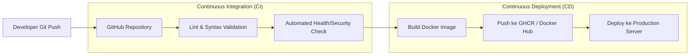

# Modul 10
## Continuous Integration dan Continuous Deployment (CI/CD) dengan GitHub Actions

---

### 1. Tujuan Pembelajaran
- Memahami konsep dasar *Continuous Integration* (CI) dan *Continuous Deployment* (CD) dalam siklus hidup DevOps modern.
- Memahami arsitektur workflow GitHub Actions: *Events, Workflows, Jobs, Runners, Steps,* dan *Actions*.
- Menyusun file deklaratif alur kerja CI/CD berformat YAML (`.github/workflows/ci-cd.yml`).
- Mengimplementasikan tahapan *Automated Linting/Testing* untuk memvalidasi kualitas kode sebelum proses build.
- Mengotomasi pembangunan (*automated build*) dan penerbitan (*publish*) Docker Image ke GitHub Container Registry (GHCR).
- Mengamankan kredensial sensitif menggunakan *GitHub Repository Secrets*.
- Mendiagnosis dan menangani kegagalan eksekusi pipeline (*edge cases & pipeline debugging*).

---

### 2. Dasar Teori

#### 2.1 Konsep CI/CD (Continuous Integration & Continuous Deployment)
Dalam praktik rekayasa perangkat lunak modern, CI/CD adalah metodologi yang bertujuan mempercepat pengiriman fitur baru ke lingkungan produksi secara andal dan bebas dari kesalahan manual.

1. **Continuous Integration (CI):** Praktik penggabungan kode dari para pengembang ke dalam repositori utama secara reguler. Setiap kali terjadi *push* atau *pull request*, sistem otomatis akan menjalankan pemeriksaan sintaks (*linting*), pengujian unit (*unit tests*), dan pembangunan artefak (*build test*) untuk memastikan tidak ada kode yang rusak.
2. **Continuous Delivery (CD):** Kelanjutan dari CI di mana setiap kode yang lolos pengujian otomatis dikemas menjadi artefak siap rilis (seperti Docker Image) dan siap disebarkan ke lingkungan produksi kapan saja melalui persetujuan manual (*manual gate*).
3. **Continuous Deployment (CD):** Tahapan otomatisasi penuh di mana setiap perubahan kode yang lolos seluruh tahapan pengujian langsung disebarkan (*deploy*) ke server produksi secara otomatis tanpa intervensi manual.


*Gambar 1. Siklus Alur Kerja Otomasi Pipeline CI/CD*

#### 2.2 Arsitektur GitHub Actions
GitHub Actions adalah platform otomatisasi alur kerja (*automation workflow*) bawaan GitHub yang mengeksekusi pipeline berdasarkan pemicu (*events*) tertentu.

**Tabel 1. Komponen Utama GitHub Actions**
| Komponen | Deskripsi dan Fungsi |
| :--- | :--- |
| **Workflow** | Alur kerja otomatis yang dikonfigurasi dalam berkas YAML di folder `.github/workflows/` |
| **Event** | Peristiwa pemicu eksekusi workflow, misalnya `push`, `pull_request`, atau jadwal `schedule` |
| **Job** | Sekumpulan tahapan langkah (*steps*) yang dieksekusi pada mesin *runner* yang sama |
| **Runner** | Server virtual (misal `ubuntu-latest`) yang disediakan GitHub untuk menjalankan tugas job |
| **Step** | Tugas individual yang dapat berupa perintah shell (`run`) atau modul terstandar (`uses`) |
| **Action** | Modul aplikasi mandiri yang dapat digunakan kembali dari GitHub Marketplace (misal `actions/checkout@v4`) |

---

### 3. Alat dan Kebutuhan Praktikum
1. Komputer dengan koneksi internet aktif.
2. Akun GitHub aktif (dapat menggunakan akun free tier).
3. Git client dan GitHub CLI (`gh`) terpasang pada terminal.
4. Repositori kode web berbasis Docker dari Modul 9.

---

### 4. Langkah-Langkah Praktikum

#### 4.1 Menyiapkan Repositori Proyek untuk CI/CD
1. Buat direktori kerja baru untuk praktikum Modul 10:
   ```bash
   mkdir -p ~/cicd-devops && cd ~/cicd-devops
   ```
2. Buat file `index.html` sederhana:
   ```bash
   cat << 'EOF' > index.html
   <!DOCTYPE html>
   <html lang="id">
   <head>
       <meta charset="UTF-8">
       <title>Aplikasi Web CI/CD Pipeline</title>
       <style>
           body { font-family: Arial, sans-serif; text-align: center; background: #0f172a; color: #fff; padding-top: 60px; }
           .card { background: #1e293b; padding: 30px; border-radius: 8px; display: inline-block; border: 1px solid #334155; }
           h1 { color: #38bdf8; }
           .badge { background: #10b981; color: white; padding: 4px 12px; border-radius: 12px; font-size: 0.85rem; }
       </style>
   </head>
   <body>
       <div class="card">
           <h1>Otomasi Pipeline GitHub Actions</h1>
           <p>Modul 10: CI Linting & Automated Docker Container Build</p>
           <p><span class="badge">Pipeline Build: Passed</span></p>
       </div>
   </body>
   </html>
   EOF
   ```
3. Buat file `Dockerfile` efisien berbasis Nginx:
   ```dockerfile
   FROM nginx:alpine
   COPY index.html /usr/share/nginx/html/index.html
   EXPOSE 80
   CMD ["nginx", "-g", "daemon off;"]
   ```
4. Inisialisasi Git repositori lokal:
   ```bash
   git init -b main
   git add .
   git commit -m "feat: inisialisasi source code dan dockerfile"
   ```

---

#### 4.2 Menulis Skrip Pipeline Alur Kerja (`.github/workflows/ci-cd.yml`)
1. Buat struktur folder wajib untuk GitHub Actions:
   ```bash
   mkdir -p .github/workflows
   ```
2. Buat file konfigurasi pipeline:
   ```bash
   nano .github/workflows/ci-cd.yml
   ```
3. Tuliskan konfigurasi deklaratif pipeline berikut:
   ```yaml
   name: Automated CI/CD Pipeline

   on:
     push:
       branches: [ "main" ]
     pull_request:
       branches: [ "main" ]

   permissions:
     contents: read
     packages: write

   jobs:
     # -------------------------------------------------------------
     # TAHAP 1: CONTINUOUS INTEGRATION (CI)
     # -------------------------------------------------------------
     code-quality:
       name: Linting & Integrity Check
       runs-on: ubuntu-latest
       steps:
         - name: Unduh Source Code (Checkout)
           uses: actions/checkout@v4

         - name: Validasi Integritas File
           run: |
             echo "=== Memeriksa keberadaan file utama ==="
             test -f index.html || { echo "File index.html tidak ditemukan!"; exit 1; }
             test -f Dockerfile || { echo "Dockerfile tidak ditemukan!"; exit 1; }
             echo "File integritas: OK"

         - name: Validasi HTML Sintaks Sederhana
           run: |
             echo "=== Menjalankan verifikasi dasar HTML ==="
             grep -q "</html>" index.html || { echo "Tag penutup HTML tidak valid!"; exit 1; }
             echo "Sintaks HTML: Valid"

     # -------------------------------------------------------------
     # TAHAP 2: CONTINUOUS DELIVERY (BUILD & PUSH DOCKER IMAGE)
     # -------------------------------------------------------------
     build-and-push:
       name: Build & Push Docker Image ke GHCR
       needs: code-quality
       runs-on: ubuntu-latest
       if: github.event_name == 'push' && github.ref == 'refs/heads/main'
       steps:
         - name: Unduh Source Code
           uses: actions/checkout@v4

         - name: Setup Docker Buildx
           uses: docker/setup-buildx-action@v3

         - name: Login ke GitHub Container Registry (GHCR)
           uses: docker/login-action@v3
           with:
             registry: ghcr.io
             username: ${{ github.actor }}
             password: ${{ secrets.GITHUB_TOKEN }}

         - name: Ekstrak Metadata Tagging Image
           id: meta
           uses: docker/metadata-action@v5
           with:
             images: ghcr.io/${{ github.repository }}
             tags: |
               type=sha,format=short
               type=raw,value=latest

         - name: Pembangunan dan Pengunggahan Image
           uses: docker/build-push-action@v5
           with:
             context: .
             push: true
             tags: ${{ steps.meta.outputs.tags }}
             labels: ${{ steps.meta.outputs.labels }}
   ```
4. Simpan file (`Ctrl + O`, `Enter`, `Ctrl + X`).

---

#### 4.3 Menghubungkan ke GitHub dan Memicu Eksekusi Pipeline
1. Buat repositori baru pada akun GitHub menggunakan GitHub CLI:
   ```bash
   gh repo create my-devops-cicd --public --source=. --remote=origin --push
   ```
   *Jika repositori sudah ada, cukup hubungkan remote dan lakukan push:*
   ```bash
   git add .
   git commit -m "ci: tambahkan workflow pipeline github actions"
   git push origin main
   ```
2. Buka antarmuka GitHub di browser, lalu masuk ke tab **Actions** pada repositori Anda.
3. Amati jalannya dua job bertahap:
   - **Linting & Integrity Check** (Job CI yang memastikan kualitas kode).
   - **Build & Push Docker Image ke GHCR** (Job CD yang membangun dan menerbitkan container image).
4. Setelah semua job bertanda centang hijau, buka halaman utama repositori dan lihat bagian kanan pada menu **Packages**. Docker image hasil build otomatis telah tersedia untuk diunduh publik:
   ```text
   docker pull ghcr.io/<username>/my-devops-cicd:latest
   ```

---

### 5. Edge Cases dan Penanganannya (Troubleshooting Guide)

#### 1. Masalah: Error `denied: permission_denied: write:packages`
* **Gejala:** Job `build-and-push` gagal pada langkah push dengan error HTTP 403: `denied: installation not allowed to Create organization package`.
* **Akar Masalah:** Token otomatis bawaan GitHub (`GITHUB_TOKEN`) secara default hanya memiliki hak *read-only* pada beberapa pengaturan organisasi/repositori.
* **Solusi Penanganan:**
  Tambahkan blok deklaratif perizinan di bagian atas file `ci-cd.yml`:
  ```yaml
  permissions:
    contents: read
    packages: write
  ```
  Atau masuk ke GitHub repository: **Settings** -> **Actions** -> **General** -> scroll ke bawah ke bagian **Workflow permissions** -> pilih opsi **Read and write permissions** -> klik **Save**.

#### 2. Masalah: Error Sintaks YAML (*YAML Syntax Parsing Error*)
* **Gejala:** Tab Actions menampilkan peringatan `Invalid workflow file: .github/workflows/ci-cd.yml#L...`.
* **Akar Masalah:** YAML sangat sensitif terhadap karakter spasi indentasi. Menggunakan karakter *Tab* alih-alih spasi, atau indentasi yang tidak sejajar akan menggagalkan pembacaan alur kerja.
* **Solusi Penanganan:**
  Hindari menekan tombol `Tab`. Selalu gunakan 2 spasi untuk setiap tingkatan hierarki YAML. Gunakan alat pemeriksa lokal seperti `yamllint`:
  ```bash
  sudo apt install yamllint -y
  yamllint .github/workflows/ci-cd.yml
  ```

#### 3. Masalah: Nama Image Berisi Karakter Huruf Besar (*Invalid reference format: repository name must be lowercase*)
* **Gejala:** Docker push gagal dengan pesan error format nama repositori tidak valid.
* **Akar Masalah:** Nama username GitHub praktikan mengandung huruf kapital (misal `JohnDoe`), sedangkan registry Docker mewajibkan semua nama image ditulis dengan huruf kecil (*lowercase*).
* **Solusi Penanganan:**
  Gunakan action `docker/metadata-action@v5` seperti pada contoh skrip praktikum di atas, karena modul tersebut secara otomatis mengubah seluruh variabel `${{ github.repository }}` menjadi format *lowercase* yang sesuai dengan standar penamaan Docker.

#### 4. Masalah: Kegagalan Menangani Kredensial Sensitif (Secrets Leakage)
* **Gejala:** Menggunakan hardcoded password atau token pribadi langsung di dalam file `ci-cd.yml`.
* **Akar Masalah:** File workflow bersifat publik dan dapat dibaca oleh siapa saja jika repositori berstatus publik.
* **Solusi Penanganan:**
  Jangan pernah menulis kredensial secara eksplisit di file YAML. Selalu simpan di **Settings** -> **Secrets and variables** -> **Actions** -> **Repository secrets**, lalu panggil di dalam workflow menggunakan sintaks `${{ secrets.NAMA_SECRET }}`.

---

### 6. Tugas dan Evaluasi Praktikum
1. **Simulasi Kegagalan Pipeline (Break the Build):**  
   Hapus tag penutup `</html>` pada file `index.html`, lalu lakukan `git commit` dan `git push` ke repositori. Amati apa yang terjadi pada tab GitHub Actions. Tunjukkan bahwa job `code-quality` berhasil mendeteksi error dan job `build-and-push` secara otomatis dibatalkan (*cancelled/blocked*).
2. **Menambahkan Multi-Environment Tagging:**  
   Modifikasi file `ci-cd.yml` agar selain menghasilkan tag `latest`, image yang dibangun juga diberi label nomor commit Git yang spesifik (`sha`).
