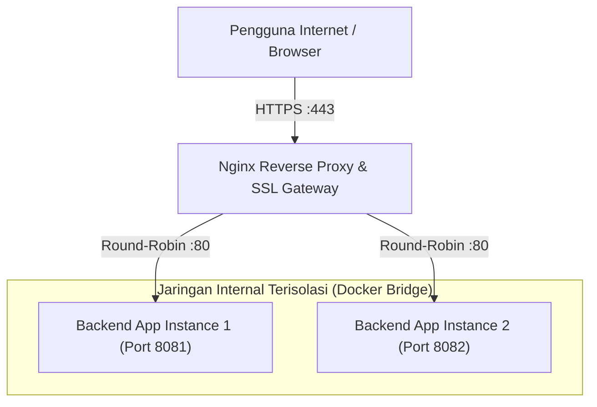

# Modul 11
## Nginx Reverse Proxy, Load Balancing, SSL/TLS, dan Observability

---

### 1. Tujuan Pembelajaran
- Memahami konsep dan perbedaan mendasar antara *Forward Proxy* dan *Reverse Proxy*.
- Mengonfigurasi Nginx sebagai *Reverse Proxy* dan *Load Balancer* untuk mendistribusikan lalu lintas ke beberapa backend server (*upstream pool*).
- Mengimplementasikan enkripsi data transit berbasis protokol HTTPS (SSL/TLS) menggunakan sertifikat digital OpenSSL.
- Mengonfigurasi pengalihan otomatis lalu lintas tidak aman (*HTTP to HTTPS redirection*).
- Menjaga keaslian informasi klien (*client metadata*) menggunakan header HTTP (`X-Real-IP`, `X-Forwarded-For`).
- Memahami pilar *Observability* melalui analisis format access log, error log, dan pemantauan kesehatan layanan secara real-time.
- Mendiagnosis dan menangani kendala teknis operasional (*edge cases*) seperti error `502 Bad Gateway` dan *Infinite Redirect Loop*.

---

### 2. Dasar Teori

#### 2.1 Forward Proxy vs Reverse Proxy
1. **Forward Proxy:** Berada di sisi klien (*client-facing*) dan bertindak sebagai perantara bagi sekumpulan klien untuk mengakses jaringan internet publik. Biasanya digunakan untuk *caching*, bypass sensor, atau filter jaringan kantor.
2. **Reverse Proxy:** Berada di sisi server (*server-facing*) dan bertindak sebagai pintu gerbang utama (*gateway*) bagi klien luar yang ingin mengakses layanan internal. Klien tidak pernah berkomunikasi langsung dengan server aplikasi di belakang layar.


*Gambar 1. Topologi Nginx Reverse Proxy dan Load Balancer Multi-Instance*

Keuntungan arsitektur *Reverse Proxy*:
- **Pusat Keamanan:** Seluruh enkripsi SSL/TLS dikelola di satu pintu (*SSL Termination*).
- **Load Balancing:** Membagi beban kerja ke banyak server secara merata.
- **Isolasi Arsitektur:** Server aplikasi internal tidak perlu mengekspos port secara langsung ke publik.

#### 2.2 Algoritma Load Balancing pada Nginx
Nginx mendukung beberapa metode distribusi beban (*traffic scheduling*):
- **Round Robin (Default):** Setiap permintaan baru diteruskan ke server berikutnya secara berurutan.
- **Least Connections (`least_conn`):** Meneruskan permintaan ke server yang sedang melayani koneksi aktif paling sedikit.
- **IP Hash (`ip_hash`):** Menjamin klien dengan IP yang sama akan selalu diarahkan ke server backend yang sama (*session persistence*).

#### 2.3 Observability: Logs dan Health Monitoring
Observability adalah kemampuan mengukur kondisi internal sebuah sistem berdasarkan output yang dihasilkannya. Pada web server dan microservices, pilar observabilitas mencakup:
1. **Access Logs:** Mencatat setiap request HTTP yang masuk (IP klien, waktu, metode HTTP, status kode, dan waktu pemrosesan).
2. **Error Logs:** Merekam kegagalan sistem, crash, atau kendala timeout.
3. **HTTP Status Code Metrics:** Indikator kesehatan layanan (2xx: Sukses, 3xx: Redirect, 4xx: Kesalahan Klien, 5xx: Kesalahan Server).

---

### 3. Alat dan Kebutuhan Praktikum
1. Komputer Windows 10/11 dengan lingkungan WSL2 Ubuntu.
2. Docker Engine dan Docker Compose yang telah terpasang dan aktif (dari Modul 9).
3. Paket `openssl` dan `curl` terpasang di sistem.
4. Teks editor nano atau Visual Studio Code.

---

### 4. Langkah-Langkah Praktikum

#### 4.1 Menyiapkan Struktur Direktori Multi-Layanan
1. Buat direktori kerja baru untuk Modul 11:
   ```bash
   mkdir -p ~/nginx-proxy-lab/{proxy,app1,app2,certs} && cd ~/nginx-proxy-lab
   ```
2. Buat halaman web untuk **Backend App 1**:
   ```bash
   cat << 'EOF' > app1/index.html
   <!DOCTYPE html>
   <html>
   <body style="background:#1e3a8a; color:white; text-align:center; padding:60px; font-family:sans-serif;">
       <h1>Backend Server Instance: ALPHA [01]</h1>
       <p>Melayani request melalui Nginx Load Balancer</p>
   </body>
   </html>
   EOF
   ```
3. Buat halaman web untuk **Backend App 2**:
   ```bash
   cat << 'EOF' > app2/index.html
   <!DOCTYPE html>
   <html>
   <body style="background:#065f46; color:white; text-align:center; padding:60px; font-family:sans-serif;">
       <h1>Backend Server Instance: BETA [02]</h1>
       <p>Melayani request melalui Nginx Load Balancer</p>
   </body>
   </html>
   EOF
   ```

---

#### 4.2 Pembuatan Sertifikat SSL/TLS Mandiri (Self-Signed SSL)
Untuk mempraktikkan enkripsi HTTPS secara lokal, buat sertifikat SSL menggunakan `openssl`:
1. Masuk ke direktori `certs`:
   ```bash
   cd ~/nginx-proxy-lab/certs
   ```
2. Buat private key dan sertifikat x509 yang berlaku selama 365 hari:
   ```bash
   openssl req -x509 -nodes -days 365 -newkey rsa:2048 \
     -keyout server.key \
     -out server.crt \
     -subj "/C=ID/ST=JawaTimur/L=Surabaya/O=PelatihanInternal/CN=localhost"
   ```
3. Pastikan dua berkas telah terbentuk: `server.key` (kunci privat) dan `server.crt` (sertifikat publik).
4. Kembali ke root direktori proyek:
   ```bash
   cd ~/nginx-proxy-lab
   ```

---

#### 4.3 Mengonfigurasi Nginx Reverse Proxy & Load Balancer
1. Buat file konfigurasi proxy pada direktori `proxy/nginx.conf`:
   ```bash
   nano proxy/nginx.conf
   ```
2. Tuliskan blok konfigurasi Nginx terpusat berikut:
   ```nginx
   events { worker_connections 1024; }

   http {
       # Format log kustom untuk kebutuhan observability
       log_format custom_devops '$remote_addr - $remote_user [$time_local] '
                                '"$request" $status $body_bytes_sent '
                                '"$http_referer" "$http_user_agent" '
                                'Upstream: $upstream_addr Status: $upstream_status '
                                'ResponseTime: ${upstream_response_time}s';

       access_log /var/log/nginx/access.log custom_devops;
       error_log  /var/log/nginx/error.log warn;

       # 1. Definisi Pool Backend Server (Load Balancing Upstream)
       upstream my_cluster {
           server app1:80;
           server app2:80;
       }

       # 2. Server Block: HTTP Port 80 (Redirect Otomatis ke HTTPS)
       server {
           listen 80;
           server_name localhost;
           return 301 https://$host$request_uri;
       }

       # 3. Server Block: HTTPS Port 443 (SSL Termination & Proxy Gateway)
       server {
           listen 443 ssl;
           server_name localhost;

           ssl_certificate     /etc/nginx/certs/server.crt;
           ssl_certificate_key /etc/nginx/certs/server.key;

           ssl_protocols       TLSv1.2 TLSv1.3;
           ssl_ciphers         HIGH:!aNULL:!MD5;

           location / {
               proxy_pass http://my_cluster;

               # Meneruskan Header Identitas Klien Asli
               proxy_set_header Host $host;
               proxy_set_header X-Real-IP $remote_addr;
               proxy_set_header X-Forwarded-For $proxy_add_x_forwarded_for;
               proxy_set_header X-Forwarded-Proto $scheme;

               # Batas Timeout Komunikasi ke Backend
               proxy_connect_timeout 5s;
               proxy_read_timeout 60s;
           }
       }
   }
   ```
3. Simpan dan keluar dari editor (`Ctrl + O`, `Enter`, `Ctrl + X`).

---

#### 4.4 Mengorkestrasi Multi-Container Menggunakan Docker Compose
1. Buat file `docker-compose.yml` pada root direktori `~/nginx-proxy-lab`:
   ```yaml
   version: '3.8'

   services:
     # Backend 1 (Instance ALPHA)
     app1:
       image: nginx:alpine
       container_name: backend-alpha
       volumes:
         - ./app1:/usr/share/nginx/html:ro
       networks:
         - internal-net

     # Backend 2 (Instance BETA)
     app2:
       image: nginx:alpine
       container_name: backend-beta
       volumes:
         - ./app2:/usr/share/nginx/html:ro
       networks:
         - internal-net

     # Reverse Proxy Gateway & SSL Terminator
     reverse-proxy:
       image: nginx:alpine
       container_name: nginx-gateway
       ports:
         - "80:80"
         - "443:443"
       volumes:
         - ./proxy/nginx.conf:/etc/nginx/nginx.conf:ro
         - ./certs:/etc/nginx/certs:ro
       depends_on:
         - app1
         - app2
       networks:
         - internal-net

   networks:
     internal-net:
       driver: bridge
   ```
2. Jalankan seluruh arsitektur layanan:
   ```bash
   docker compose up -d
   ```
3. Verifikasi bahwa ketiga kontainer berjalan normal:
   ```bash
   docker compose ps
   ```

---

#### 4.5 Pengujian Load Balancing dan Observabilitas Log
1. Jalankan pengujian HTTP redirect menggunakan `curl`:
   ```bash
   curl -I http://localhost
   ```
   *Amati bahwa server mengembalikan status `HTTP/1.1 301 Moved Permanently` dengan header `Location: https://localhost/`.*

2. Uji endpoint HTTPS (gunakan flag `-k` untuk mengabaikan peringatan sertifikat self-signed pada curl):
   ```bash
   for i in {1..4}; do curl -sk https://localhost | grep "Backend Server Instance"; done
   ```
   *Output terminal akan menampilkan balasan secara bergantian antara instance ALPHA dan BETA:*
   ```text
   <h1>Backend Server Instance: ALPHA [01]</h1>
   <h1>Backend Server Instance: BETA [02]</h1>
   <h1>Backend Server Instance: ALPHA [01]</h1>
   <h1>Backend Server Instance: BETA [02]</h1>
   ```

3. Pantau Observability Log Nginx secara langsung:
   ```bash
   docker compose logs -f reverse-proxy
   ```
   *Perhatikan baris log yang mencatat alamat `Upstream: 172.x.x.x:80` dan `ResponseTime: 0.000s` untuk setiap request.*

---

### 5. Edge Cases dan Penanganannya (Troubleshooting Guide)

#### 1. Masalah: Error `502 Bad Gateway` Saat Mengakses Reverse Proxy
* **Gejala:** Browser menampilkan pesan kesalahan `502 Bad Gateway` dari Nginx.
* **Akar Masalah:**
  - Kontainer backend (`app1` atau `app2`) dalam kondisi mati (*crashed* atau *exited*).
  - Nama host upstream pada konfigurasi Nginx salah ketik atau tidak berada di dalam satu Docker network bridge yang sama.
* **Solusi Penanganan:**
  1. Cek kesehatan kontainer backend:
     ```bash
     docker compose ps
     ```
  2. Periksa log detail error pada proxy:
     ```bash
     docker compose logs reverse-proxy
     ```
     Jika muncul `connect() failed (111: Connection refused) while connecting to upstream`, pastikan port target pada `server app1:80;` sesuai dengan port yang didengarkan oleh service di dalam kontainer backend.

#### 2. Masalah: Browser Menolak Mengakses Website (*Your connection is not private / NET::ERR_CERT_AUTHORITY_INVALID*)
* **Gejala:** Peramban web menampilkan peringatan keamanan merah saat mengakses `https://localhost`.
* **Akar Masalah:** Sertifikat SSL yang dibuat adalah *self-signed*, artinya tidak ditandatangani oleh *Certificate Authority* (CA) publik resmi seperti Let's Encrypt atau DigiCert.
* **Solusi Penanganan:**
  - Pada lingkungan pengujian laboratorium lokal: Klik tombol **Advanced** (Lanjutan) pada browser, lalu pilih **Proceed to localhost (unsafe)**.
  - Untuk lingkungan produksi publik: Gunakan utility `certbot` dari *Let's Encrypt* dengan domain publik yang terdaftar.

#### 3. Masalah: Kehilangan Alamat IP Asli Pengunjung (*Client IP Spoofing / Logging 172.x.x.x Only*)
* **Gejala:** Aplikasi backend mencatat semua request berasal dari IP Docker internal (`172.18.0.x`), bukan IP asli klien.
* **Akar Masalah:** Nginx bertindak sebagai perantara koneksi TCP baru ke backend tanpa meneruskan header HTTP klien.
* **Solusi Penanganan:**
  Pastikan header forwarder terpasang di blok `location /`:
  ```nginx
  proxy_set_header X-Real-IP $remote_addr;
  proxy_set_header X-Forwarded-For $proxy_add_x_forwarded_for;
  proxy_set_header X-Forwarded-Proto $scheme;
  ```

#### 4. Masalah: Siklus Pengalihan Tak Hingga (*Infinite Redirect Loop - ERR_TOO_MANY_REDIRECTS*)
* **Gejala:** Browser menampilkan error *Too Many Redirects*.
* **Akar Masalah:** Blok HTTPS (`listen 443`) secara tidak sengaja meneruskan request ke port HTTP tanpa meneruskan informasi `$scheme`, sehingga aplikasi backend berulang kali mengirimkan instruksi redirect 301.
* **Solusi Penanganan:**
  Pastikan backend aplikasi mengenali header `X-Forwarded-Proto https` atau pisahkan secara tegas logika redirect hanya pada blok port 80.

---

### 6. Tugas dan Evaluasi Praktikum
1. **Eksplorasi Algoritma Load Balancing:**  
   Ubah konfigurasi blok `upstream my_cluster` pada `proxy/nginx.conf` dengan menambahkan direktif pembobotan (*weighted load balancing*):
   ```nginx
   upstream my_cluster {
       server app1:80 weight=3;
       server app2:80 weight=1;
   }
   ```
   Jalankan `docker compose restart reverse-proxy` dan lakukan uji 8 kali request berturut-turut. Catat dan jelaskan distribusi respon yang dihasilkan.
2. **Simulasi High Availability (Failover Test):**  
   Matikan salah satu kontainer backend menggunakan perintah `docker stop backend-alpha`. Lakukan kembali request ke `https://localhost`. Buktikan bahwa Nginx secara cerdas mengalihkan 100% traffic ke backend BETA yang masih hidup tanpa menyebabkan down bagi pengguna.
